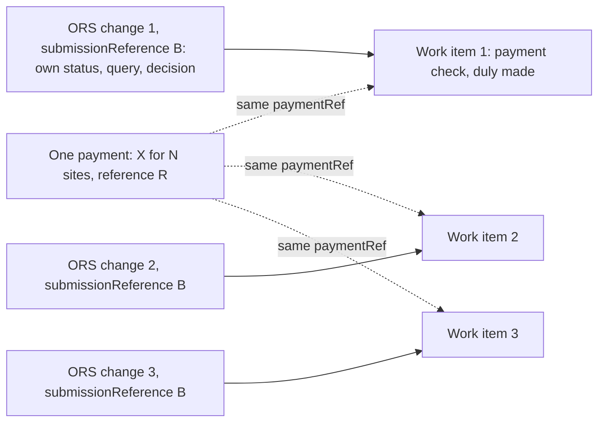

Shape chosen: C1. First slice built in RA-744 PR 1 (envelope, `details`, `AccreditationDetails`, round-trip and guard tests, design doc v6.6). The other four details types, typed CRUD and the `applicationType` index follow in RA-745; the validator and the guard key follow after.

# Register & Enrol application types

How the new domain model in `epr-register-enrol-backend` should represent six kinds of application. Prepared 5 November 2026 from the code and design doc at the commits listed at the end, and from answers given by James Atherton. **Updated the same day** after review with Adam Slack: option C1 (a common envelope plus per-type `details`) replaces C2 as the chosen shape, and the release position of the domain model redesign is added. The phase 1 index check has since been run, and its result is under "Rules and indexes". Verified means checked against the named source. Assumption means nobody has confirmed it.

**Chosen: all six types share one collection. Each document has a common envelope of IDs and lifecycle fields at the top level, and a `details` sub-document whose shape depends on `applicationType`, with a schema per type. Each type gets its own rules and its own approval effect. ORS (overseas reprocessing site) batches become one application per ORS, linked by a `submissionReference`, with no batch collection.**

Storage

One collection, `applicationVersions`, for all six types. Batches need no collection of their own: each ORS application carries a `submissionReference`. Offline payment is by bank transfer. Online payment uses GOV.UK Pay, and its result is recorded in the backend. The regulator's payment check is recorded on the case management side. Legacy `accreditationApplications` stays accreditation-only and heads for archive as planned.

Code shape

One `ApplicationEntity` class is the envelope: IDs, `applicationType`, status, payment, case link, submitter and query. Its `Details` property is an abstract `ApplicationDetails`, with a sealed details class for each group.

Enforcement

Business rules, such as one open change per ORS, live in application code and are chosen by `applicationType`, keeping them flexible. Type-specific IDs such as the ORS ID stay in `details`. The database stays simple: an optional top-level guard key with one generic unique index, and an optional small validator. Both are still to agree.

Grouping

**New and Reapply** share one details class with a `kind` field. **In-year ORS**, **in-year tonnage**, **New Registration** and **Annual Charge Payment** each get their own details class.

Release

Phase 1 (empty model) releases on Monday 9 November. None of its indexes use a field that moves under `details`, so it doesn't block C1. Its production flag is still off; PR #5093 turns it on and James merges it on Monday before the release, once QA (quality assurance) signs off. Phases 2 and 3 are not in production, so this shape can be rolled in for testing next week with no data migration.

Case management

Yes, work item types are needed: four new types beside `re-accreditation`. All of them link back through `operatorApplicationId`, set to the application's `entityId`. Query, duly-making and decision logic moves out of the ReAccreditation module so new types can share it.

### Main reasons

- **A clear boundary.** Anything outside `details` is common to every type, so list queries and projections never touch type data by accident, and each type's inner shape can evolve and be versioned on its own (Adam, James).
- **Nothing is stored flat in production yet.** Phases 2 and 3 of the domain model redesign haven't gone live, so moving the accreditation fields under `details` is a change to docs, tests and mappers, not to live data (James). That cost was the only reason C2 was preferred.
- **The lifecycle is shared and the data is not.** Every type follows the same flow, confirmed by James. Yet `ApplicationEntity` creates `Prns`, `BusinessPlan` and `SamplingPlan` by default, so a single shape would give a tonnage change empty accreditation sections. Verified `DomainModel/Entities/ApplicationEntity.cs`
- **Rules need to hold across types.** The check that a site is not held by another open application reads every open application on a registration, and it has to see in-year changes too. Verified `ApplicationModelSync.cs:750-760`
- **One application per ORS makes the site rule enforceable.** Each ORS needs its own decision and query, and an index cannot catch a repeat inside one document. Verified `DomainModelIndexRuleTests`, `OverseasSiteIndexes_RepeatInsideOneOrsDocument_IsNotCaught`
- **The work item link already exists.** management-be `main` already enforces one work item per `operatorApplicationId` and replays a repeated submit. If every ORS change is an application, it needs no second identity. Verified `WorkItemPersistence.cs:767`, `WorkItemService.cs:208-232`

## Options compared

Criteria are in priority order. Delivery risk is shown as a consequence and did not decide the ranking. C1 and C2 score the same on the first three criteria; C1 is chosen because its delivery risk dropped once it was clear nothing is stored in production yet.

| Option | 1. Validity and invariants | 2. Ease of adding types | 3. Fit with management-be | Delivery risk |
| --- | --- | --- | --- | --- |
| A. Overloaded: one class with a type field | **Poor.** Every type can hold every field. `accreditationId` would mean "created by" on one type and "changes" on another. Rules live only in application code, unless a schema validator is added. | Cheap at first, then each type adds more nullable fields. | Good: one link and one shape. | Lowest now, highest later: invalid combinations can be saved without error and only surface when something reads them. |
| B. Specific: unrelated class and collection per type | **Strong per type, weak across types.** Natural indexes, but the site rule would span several collections. | **Poor.** Status, payment, query and case link are written again for each type. | Good: maps one-to-one to work item types. | Medium. The legacy mirror stays clean, but there is more to build. |
| C1. Hybrid: common envelope with a polymorphic `details` field, one collection (chosen) | **Strong.** A type's `details` hold only its own fields, and the envelope is guaranteed common. | **Good.** A new type needs a details class, its rules and an approval effect. The envelope is untouched. | **Good.** One application, one work item, one link. | **Low-medium.** Existing accreditation fields move under `details`, changing the mapper, sync, tests and design doc §5.1. Phases 2 and 3 aren't in production, so this rolls in for testing next week with no data migration. |
| C2. Hybrid: abstract core, sealed subclasses, one collection (previously recommended) | **Strong.** Same validity as C1. | Good. | Good. | Medium. Chosen earlier only because flat field paths were assumed to be live. Type fields sit beside common ones, so the boundary is weaker. |
| C3. Hybrid: shared core embedded, several collections | Strong per collection. The cross-type site rule spans collections. | Medium. Each collection adds its own indexes, repository wiring and list queries. | Good. | Medium-low. The legacy mirror and reconciliation are untouched. |

**C2 is the fallback** if the C# driver can't round-trip a polymorphic `details` property cleanly. **C3 is the other alternative.** Its advantage is real: reconciliation and migration never see the new rows. It would only have become the better choice if a site could have several open changes, and James has confirmed it can't.

## The shape

```
ApplicationEntity : VersionedEntityBase             // applicationVersions: the common envelope
  EntityId, ApplicationType, RegistrationId          // ApplicationType is the discriminator, top level, indexed
  ApplicationReference, SubmissionReference          // a single application is a submission of one
  Status, SubmittedBy, WithdrawalReason, DateSent, DateLastEdited, Query
  PaymentReference, ChargePence, TotalDuePence      // what the operator was asked to pay, fixed at submit
  PaymentMethod (Online | Offline)
  GovPayPaymentId?, GovPayStatus?                   // online only: GOV.UK Pay result, the same on every application in a batch
  CaseManagementWorkItemId, CaseManagementStatusUpdatedAt
  ExclusivityKey?                                   // optional guard, written by app code (see Rules)
  Details : ApplicationDetails                      // shape chosen by ApplicationType

abstract ApplicationDetails { SchemaVersion }

sealed AccreditationDetails : Kind (New | Reapply), Year, SourceAccreditationId,
    Prns, BusinessPlan, SamplingPlan, BesEvidence, OverseasSitesSection,
    ApplicationOverseasSites[], ReservedAccreditationNumber, AccreditationId,
    NewApplicantDetails?                            // required only when Kind = New
sealed OrsChangeDetails      : TargetAccreditationId, OverseasSiteId, Declaration, ChangeKind,
                               Site (ApplicationOverseasSiteEntry)
sealed TonnageChangeDetails  : TargetAccreditationId, FromBand, ToBand
sealed NewRegistrationDetails: registration journey section statuses (data sits on the created Registration)
sealed AnnualChargeDetails   : ChargeYear

// The regulator's check, recorded in management-be on the work item (epr-register-enrol-management-be)
PaymentCheck { Scope (Submission | Application), Method (Online | Offline), PaymentRef,
               GovPayPaymentId?,                    // from the backend; builds the regulator's "check in GOV.UK Pay" link
               PaidOn?,                             // the only thing recorded today (James)
               CheckedBy?, CheckedAt? }             // possible later additions; not needed yet
```

Field names are still open, except where RA-745 settled them (James, 6 November 2026): an ORS change's `Declaration` records who declared and when; it records a set of `ChangeKinds` (`AddRegisteredSite`, `AddNewSite`, `EditSite`, `ChangeInterimSites`), because an edit and interim site changes to one ORS travel in one application; and New Registration's section statuses are a list of named sections until the journey's sections are agreed. The shared flow and `ChangeReason` stay in their existing places. Each approval effect runs in a transaction, as the current write paths do.

### Envelope rules (agreed with Adam)

- **A field goes in the envelope only if every type has it and it is used for querying.** Otherwise the envelope slowly fills with nullable fields, which is option A again. The envelope isn't expected to change often.
- **The discriminator is at the top:** `applicationType`, indexed. The C# driver also writes its own `_t` inside `details` for a polymorphic property. Keep the two in agreement, or derive one from the other.
- **Type-specific IDs stay in `details`,** such as the ORS ID, because other types don't have them.
- **Each details type carries a `schemaVersion`** so its shape can change without touching the envelope or other types.

Assumption The Mongo driver round-trips a polymorphic `Details` property through `VersionedMongoRepository<T>`. **Run in RA-744 PR 1:** `ApplicationDetailsRoundTripTests` round-trip an accreditation `Details` through `VersionedMongoRepository<T>` on a replica set, with `_t` equal to `applicationType`. The other four types are tested as they gain a details class (PR 2). No production data exists in this shape yet, so any test or development data that fails to read can be re-derived. Each details class is also walked by the schema guard tests, which now follow `[BsonKnownTypes]`: they walk declared types and would otherwise silently skip fields under `details`. Verified `DomainModelIndexRuleTests.cs:447-541`

### Can the accreditation-shaped fields stay on a shared shape?

No. Each one is valid only for New and Reapply, so each moves into `AccreditationDetails`.

| Field | Finding |
| --- | --- |
| `year` | It means "accreditation year applied for". An in-year change takes the year from its target, and an annual charge has its own charge year. A shared field would carry three meanings. |
| `prns`, `businessPlan`, `samplingPlan` | Created by default on the entity, and §3.4 requires all sections Completed to submit. They mean nothing for the other four types. |
| `reservedAccreditationNumber` | Only an approval that creates an Accreditation mints a number. An in-year change must never hold one, because a number is fixed once approved (Q7). |
| `accreditationId` | "Set when approved". In-year changes need a target from the start, which is a different fact, so they get `TargetAccreditationId`. `ChangeInfo.ApplicationId` already records which application caused a new Accreditation version. `ChangeInfo.cs` |

## The six types

| Type | Specific data | Invariants | What approval does | What rejection does | Work item type |
| --- | --- | --- | --- | --- | --- |
| New Accreditation | As Reapply, plus a section for a couple of extra pages. Not seeded. Assumption Fields not yet listed. | One live or approved per registration and year (§9.7). Registration must be approved. Assumption | Creates the Accreditation, activates Proposed sites, applies site edits (§3.4). | Proposed sites become Discarded. | `re-accreditation` with the kind shown on the case |
| Reapply | Current fields. Seeded from the previous Accreditation, or from ReEx data for 2027. Every application in the legacy collection is stored as `kind = Reapply` (**Assumption** in RA-744: New applications are only ever created in the model, never in legacy). | As above. `kind` must be explicit, because `sourceAccreditationId` is also null for migrated 2027 reapplications. Verified §3.2 | As above. | As above. | `re-accreditation` |
| In-year ORS change | Target Accreditation, batch, kind of change, one ORS entry with `proposedChanges`, BES evidence and interim sites. | 2027+ accreditations only. One application per ORS. One open change per ORS (James: confirmed). | By kind: adds the ORS to the Accreditation as a new version; activates a Proposed ORS; applies edits as a new ORS version; applies interim site changes as a new ORS version. | Registration and Accreditation unchanged. Proposed sites Discarded. Charge kept. Assumption | New: `in-year-ors-change` |
| In-year tonnage change | Target Accreditation, from band, to band, charge. | Increase only (James; not yet in the design doc). One open per accreditation. Assumption Checked at submission and approval. Assumption Can run alongside ORS changes (James). | New Accreditation version with reason `TonnageBandChanged`, effective from approval. Assumption | No change to the band. **The charge is taken** (James). | New: `in-year-tonnage-change` |
| New Registration | Journey section statuses. The data sits on a Registration created when the journey starts (James). | No registration number until approval (James). Hidden from ReEx and the public register until approved. One live per organisation, material, and site or exporter. Assumption | Registration moves from `created` to `approved`, its number is minted, and Proposed sites activate. | Registration moves to `rejected`. A new application reuses it through `rejected → created`. Assumption | New: `registration-application` (name already in management-fe's stub) |
| Annual Charge Payment | Charge year, charge. Little else. Assumption | One live or approved per registration and year. | Records the charge as paid on a new Registration version. **The Registration has no field for this yet.** Assumption | Only if payment never arrives or the application was made in error. Registration status unchanged. Any refund is outside the service. Assumption | New: `annual-fee-payment` (name already in the stub), with a shorter workflow |

**Is New plus Reapply really one type?** Yes, on current evidence. James describes the same flow, a couple of extra pages and no seeding. The seed design already handles "no previous Accreditation" (§3.2). A different charge, deadline or approval effect would count against it.

## Rules and indexes

Today the only business index on `applicationVersions` is `applicationReference`. The one-live-application rule is a planned follow-up (R12). Verified `ApplicationVersionPersistence.cs`

### What phase 1 creates on `applicationVersions`

Phase 1 creates five indexes on this collection, and all of them use fields that stay in the envelope. No index uses `year`, `prns`, `businessPlan`, `samplingPlan` or `applicationOverseasSites`, and the domain model defines no validators. So **phase 1 doesn't block C1**. Verified code at backend `main` 765631c, tag 0.173.0; not checked against a live database

| Index | Fields | In C1 |
| --- | --- | --- |
| `entityId_version_u` | `entityId`, `version` | Stays top-level |
| `entityId_current_u` | `entityId`, where `isCurrent` is true | Stays top-level |
| `entityId_asof` | `entityId`, `validFrom`, `validTo` | Stays top-level |
| `registrationId_asof` | `registrationId`, `validFrom`, `validTo` | Stays top-level |
| `applicationReference_current_u` | `applicationReference`, where current and present | Stays top-level |

The other model collections have their own indexes, but C1 doesn't change their shape. For example, `year` is indexed on accreditations, not applications. The `applicationType` index and the optional guard key aren't in phase 1. The `applicationType` index is added in RA-745 as `registrationId_applicationType_current` and the guard key in RA-747 as `exclusivityKey_current_u` (no writer until the one-live-application rule is built), and the startup schema check will then expect them. An index that is no longer defined isn't removed automatically: the reconciler only drops one whose key matches a new index but whose options differ. Verified `VersionedIndexes.cs`, `MongoIndexReconciler.cs`, `DomainModelSchemaCheck.cs`

**Rules live in application code (agreed with Adam).** `applicationType` decides which rules apply. For example, for an ORS change the application refuses a new open application for an ORS ID that already has one, even though the ORS ID sits in `details`. This keeps the database model simple and the rules flexible. Using a different rule per type also resolves the conflict where in-year changes arrive in the same year as an approved application.

**Optional guard, to agree.** A check in code alone can let two submits that arrive at the same moment both pass. The cheap guard: the application writes a top-level `ExclusivityKey` string on open applications, under one generic partial unique index built from the existing `VersionedIndexes.CurrentUnique` and `StringPresent` helpers. The application still decides the rule and the key; the index only catches the race, and needs no type-specific filter. The alternative is a transaction around check-and-insert. Keys, if used:

| Type | Key | Released when |
| --- | --- | --- |
| New, Reapply | `accreditation\|{registrationId}\|{year}` | Rejected or withdrawn. Not released when the Accreditation is cancelled: cancellation and reinstatement are new versions of the same Accreditation, so there is no replacement application for the same registration and year (Q36, James's working view). |
| In-year ORS | `ors-change\|{overseasSiteId}` | Approved, rejected or withdrawn |
| In-year tonnage | `tonnage-change\|{targetAccreditationId}` | Approved, rejected or withdrawn |
| New Registration | `registration\|{org}\|{material}\|{site or exporter}`. **Not built in RA-747** (James, 6 November 2026): no key until the journey decides how a site is identified | Rejected or withdrawn |
| Annual charge | `annual-charge\|{registrationId}\|{chargeYear}` | Rejected or withdrawn |

**Limit:** a new ORS entity gets its id when it is proposed, so the ORS key always has a value. But an accreditation application holds a list of sites, so it can't take a per-site key (`OverseasSiteIndexes_RepeatInsideOneOrsDocument_IsNotCaught`). The check between an in-year ORS change and an open reapplication stays in code (`HeldInFlightElsewhereAsync`), and it must run in both directions.

**Migration:** if the guard is used, known duplicate live legacy applications (§6.3) would break the index, so those rows hold no key until repaired.

## Schema validation

MongoDB can reject documents that don't match a `$jsonSchema` validator attached to a collection, whichever writer sends them. The new collections have none today. Verified `DomainModel/` at `main`; a `$jsonSchema` script exists only for the legacy collection, `Utils/Mongo/Scripts/create-accreditation-applications-collection.js` **Optional, and kept small if added.** Adam's steer is not to over-complicate the database model, so the C# details classes and application code are the main protection. A validator is a later, low-cost extra, not a prerequisite.

| Layer | Stops | Doesn't stop |
| --- | --- | --- |
| C# details classes | Our code setting a field that doesn't belong on a type | Scripts, or anything else that bypasses the classes |
| Schema validator | Any writer saving an unknown type, a missing required field or a field that belongs to another type | Broken references or rules across documents. Users with the bypass privilege can skip it |
| Unique indexes | Two open applications with the same key | Anything about a document's shape |

### What it would check

- The envelope's required fields, and `applicationType` is one of the known types.
- Optionally, one `oneOf` branch on `details` per type for its required fields, such as the target on in-year changes and `fromBand` and `toBand` on tonnage.

The envelope makes this simpler than under C2: one fixed top-level schema, with type checks confined to `details`. A full copy of every class would have to change in step with the C# on every field, so don't do that.

### Rollout, if added

- **Start in `warn` mode.** Under dual-write, a failed model write fails the whole request and rolls back the legacy write (§6, D9). A validator in `error` mode with a bad rule would therefore block live operator requests.
- **Switch to `error` once clean.** The team has no access to production data (§7 R15), so someone with production access would have to check the warnings.
- **Use `moderate`, not `strict`.** Writing a new version also updates the previous document to close it. Under `strict`, that update re-checks the whole old document against the current validator, so if a type's `details` schema has changed since, closing the old version fails and so does the new write. `moderate` doesn't re-check documents that were already invalid.
- **Add a test** that each details builder passes and that cross-type documents fail, on the same replica set as the index rule tests. There's no existing mechanism for applying validators to the new collections, so one must be added alongside index creation. Assumption Not designed or run yet.

## ORS batches and payment



### Payment requirements (James)

- For an ORS in-year change, payment is made against the batch, and **duly made is per individual application**.
- Payments could potentially be made against individual applications instead.
- **Offline is bank transfer.** This is the only route that exists today. Verified no GOV.UK Pay integration in the four repos
- **Online is GOV.UK Pay.** To the operator it is part of the frontend journey, but the frontend hands off to GOV.UK Pay's own pages and the operator is returned to the service afterwards. The result is recorded in the backend. management-be shows the regulator a link to check the payment in GOV.UK Pay. **Timing:** soon, but not before the remodelling work is complete.
- Duly making will often involve checking the payment.
- **Where each fact is recorded.** The backend holds what the operator was asked to pay and, for online payments, the GOV.UK Pay payment id and outcome. management-be holds the regulator's check: the date paid, who checked and when. This matches today for offline: the payment date is stored on the work item. Verified `ReAccreditationPayload.cs:205`

### Do we need a batch collection?

No. Each application can carry a `submissionReference`, and the payment can be recorded on each work item it covers.

| Option | For | Against |
| --- | --- | --- |
| `submissionReference` on each application, payment on each work item (recommended) | No extra collection or parent to keep in step. Batch and single-application payment use one shape. Each case records its own check when duly made, so offline payment has no shared state to update. Fits Mongo: the declaration and amounts are fixed, so copying them is safe. | An online payment's status would be held on every work item it covers. management-be uses no Mongo transactions today, so those updates can't be atomic without adding them. Verified no session or transaction use in `EprRegisterEnrolManagementBe` at `main` No single place holds "amount received for this payment". |
| `submissionReference` plus a `payments` collection in management-be | One record per real payment, with its own status, provider id and received amount, so one update covers every case. Copes with part payments, refunds and reconciliation. | A new collection, and two places to read during duly-making. Not justified until a payment has shared state that changes. |
| Separate batch collection (previous proposal) | One place for the declaration, total and payment. | Effectively a parent table. Doesn't help when a payment is against one application, so a payment shape would still be needed on applications. |

**Add a `payments` collection in management-be if** a regulator must record one received amount against a whole payment, a payment can arrive in parts, or the service has to reconcile with a provider or finance. Online payment alone no longer triggers this: GOV.UK Pay keeps the payment's own record and status, the backend records the result, and the regulator checks it in GOV.UK Pay through the link. Moving later still means a data migration, so product should answer the other triggers before build.

### Online payment with GOV.UK Pay

**Timing (James):** soon, but only after the remodelling work is complete. So it builds on the C1 shape, and the envelope's payment fields (`PaymentMethod`, `GovPayPaymentId`, `GovPayStatus`) can be added with the GOV.UK Pay work rather than in next week's change. Until then, every payment is offline.

1. The operator reaches the pay step in the frontend and chooses to pay online.
2. The backend creates the GOV.UK Pay payment for the amount due (the batch total, or one application's charge) and stores its payment id on every application it covers. The frontend sends the operator to GOV.UK Pay's pages.
3. GOV.UK Pay returns the operator to the service. The backend asks GOV.UK Pay for the payment's status and records the outcome. GOV.UK Pay's guidance is not to rely on the return alone, because it doesn't carry the outcome. Assumption To confirm against GOV.UK Pay's current documentation during build.
4. Submission creates the work items as today. Each carries the GOV.UK Pay payment id, so management-be can show the regulator a link to that payment in GOV.UK Pay. Assumption The id is sent in the work item payload rather than looked up later.
5. The regulator follows the link, checks the payment and duly makes each application, recording the check on its work item as for offline.

Risk The link only works for regulators who have a GOV.UK Pay account with access to the service's payments. Agree who needs access, and how it is granted and removed, before go-live.

Risk If an operator pays but doesn't come back, the backend never learns the outcome from the return. Decide whether the backend checks unfinished payments again later, and what the operator sees if they come back to a part-paid submission.

### How it works

- **The batch** is the set of applications sharing a `submissionReference`. Regulators do not decide it. A single-site submission is a batch of one, so there is only one path.
- **Draft:** the batch exists once its first site is added, and removing the last site removes it. The per-ORS key already stops a site joining two drafts, so #229's one-draft-per-accreditation index may not be needed. Assumption
- **Submission:** the declaration and amounts are copied to each application in one transaction. Then one call per application creates its work item, safe to retry through `operatorApplicationId`. The batch counts as fully submitted when every application has a work item id.
- **Payment:** the regulator's check is recorded on each work item in management-be. `Scope` says whether it covers the batch or one application, and work items covered by the same payment share a `PaymentRef`. An online payment's GOV.UK Pay id and outcome are recorded on the applications in the backend, and each work item carries the id for the check link. Offline waits for the regulator to match the bank transfer.
- **Duly made:** the regulator duly makes each application individually, seeing the batch's total and sibling cases. That action records the check and date on that work item only, starts its SLA clock and pushes the new status to the backend. Whether the date is prefilled from the first case is a screen decision.
- **Underpayment:** query the cases concerned and don't duly make those the money doesn't cover.
- **Offline payments, including part payments:** the service only needs the regulator to record that they have seen the amount is fully paid, with the date (James). How they match bank transfers, and whether money arrives in one payment or several, is handled outside the service. Until it's fully paid, the case is queried and not duly made. That works with today's date-only record and needs no `payments` collection.
- **Decisions:** the regulator can approve one case alone, query one alone, or approve several in one action, and each keeps its own outcome (James). Run a bulk approval one case at a time and report a result per case, because partial failure is possible. Approved sites take effect, and refused sites do not.

Risk The offline payment reference identifies only the organisation, so a regulator can't tell from it which batch or application a payment belongs to. That matters more now that payments can be against either. Verified frontend `paymentDetails.js`, `buildPaymentReference`

### How payment references are built

The reference is not unique beyond the organisation. It is built in the frontend by `buildPaymentReference` (`paymentDetails.js:80`), with only three variable parts: the nation, the organisation number and, in England only, whether the operator is an exporter. Verified James, against frontend `origin/main` d7f3446 Product had thought references were "pretty much unique" (Kev), so this is worth sharing with them.

| Nation | Format | Example, organisation 500500 |
| --- | --- | --- |
| England, reprocessor | `PR/PK/REP/{organisationNumber}` | `PR/PK/REP/500500` |
| England, exporter | `PR/PK/EXP/{organisationNumber}` | `PR/PK/EXP/500500` |
| Wales | `PREX/{organisationNumber}` | `PREX/500500` |
| Scotland | `E800 81581/{organisationNumber}` | `E800 81581/500500` |
| Northern Ireland | `NI/PR/REEX/{organisationNumber}` | `NI/PR/REEX/500500` |

- **Nation:** `application.nation`, which the backend derives from the registration's regulator. It defaults to England if missing, so an application without a nation gets an England-format reference and England's bank details.
- **Organisation number:** `application.organisationNumber`. This is the only part that identifies who is paying.
- **Exporter flag:** `application.isExporter`. Only England's format uses it.

**Working answer (James):** the regulator matches a bank payment to a batch or application by organisation, date and amount, outside the service; the service only records that the amount is fully paid. The team thinks a duplicate is unlikely. The likeliest clash is one organisation sending two same-sized payments close together, for example two single-site ORS changes at £328 each. In that case either match is acceptable, as long as each payment is matched only once. If it becomes a problem, adding the `submissionReference` to the payment reference the operator is shown would fix it. Assumption Confirm with regulators that matching by date and amount works for them.

## Points tested

| Question | Finding |
| --- | --- |
| Does the state machine need a payment state? | Recommend no new application status. An online payment's outcome comes from GOV.UK Pay and is recorded in the backend; the regulator's check is a record on the work item in management-be. Today operators pay by bank transfer and a regulator records the date at duly-making, which anchors the SLA. Verified `paymentDetails.js`; `ReAccreditationDulyMakingService.cs` Online payment means "paid" can be known before a regulator looks, so paid and checked are separate facts. `DulyMade` stays the regulator's per-application step. Assumption Online payments also go through duly-making; "often involves checking" leaves open whether any can skip the check. |
| Does approval always create an Accreditation? | No. §3.4's side effect becomes one approval effect per type, as in the table above. "Created by the approval push only" stays true of the Accreditation itself. |
| Does the §3.2 overlay fit in-year edits? | Yes. James confirms everything waits for approval, so `proposedChanges` and Proposed sites can be reused. Rejecting a change leaves the registration untouched. Product still owns Q12. R17 already notes that an overlay can go stale, which is one reason for the rule, now confirmed by James, that an ORS can have only one open change, so no field-level conflict rules are needed. |
| New Registration has no Registration to point at | Create it with status `created` when the journey starts (James). `reExRegistrationId` and `registrationNumber` are already nullable, and §3.4 already shows this start state. The principle that an Application owns no registration data still holds. Verified `RegistrationEntity.cs`, `RegistrationPersistence.cs` |
| Does every type need a common link back? | Yes: `operatorApplicationId` = the application's `entityId`, as §3.1 requires. The spike refuses this field and adds `operatorRequestId`, probably because its request is not an application and the approved application's id would hit the unique index. Assumption Chris to confirm. With one application per ORS, that reason goes away. |

## Impact on management-be

**Status (James):** the work item changes haven't started; the ticket is being written. The points below and in "Impact on management-fe" are ready to feed into it, so it can be scoped to the C1 shape and one application per ORS from the start.

- **Move the shared workflow out of ReAccreditation.** Query, duly-making, decision, status push and notifications all live in that module and check its type id, so a new type gets none of them. Verified `ReAccreditationStatusPushHook.cs:134`, `ReAccreditationQueryPushHook.cs:61`
- **Leave `re-accreditation` stable.** Its type id and frozen template snapshots stay as they are (v18, with migrations). New types start at v1 from a shared workflow definition, so no existing case changes.
- **Annual charge** uses a shorter workflow: checking the payment and recording its date is the approval, with query still available. Assumption
- **Add bulk approve.** It is new, because an action applies to one work item today. Verified `WorkItemEndpoints.cs` Duly-making stays per work item. Work items carry a `submissionReference` so a caseworker can see the batch's total and sibling cases.
- **Record the payment check.** The regulator records a date, and that stays the requirement for now (James); it may change later. Make the date available to every work item type, with the method, and keep the record easy to extend with an amount or who checked. For online payments it also shows a link to the payment in GOV.UK Pay, built from the id the backend sends. The payment's own status stays in GOV.UK Pay and the backend.
- **Add one generic backend push route.** Status pushes go to `/api/v1/accreditation-applications/case-management/{id}`, which assumes a legacy application. Verified `HttpOperatorBackendPushAdapter.cs:60` New types need a route keyed on `entityId`, which runs the type's approval effect.
- **Clean up Core.** `WorkItemQueryBinding` uses ReAccreditation models, and an internal `WorkItemPersistence` constructor registers only that type. Verified
- **References.** In-year changes do not use the AP reference generator: since RA-492 (regulators agreed, 10 Nov 2026) management-be gives them `IYC-{code}-{yyyy}-{seq:D5}` references (`add-overseas-site` → `ORS`) from a sequence per change type per year, so repeat changes for one organisation and material no longer compete for the same reference. The retry problem remains for any new type that is not an in-year change and still uses the AP generator: repeat submissions for one organisation and material can use up its retries. The spike appended a GUID to avoid this. Keep that idea for those types.

## Impact on management-fe

- **A new type needs more than its documented one line.** The list card hard-codes "reaccreditation" and `detail.controller.js` checks the type id. Verified `routes/work-items/index.njk`, `detail.controller.js:561,643`
- **Filters.** `registration-application` and `annual-fee-payment` stubs become real. "Accreditation" filters by kind instead of type id, which needs a new query parameter. Add in-year filters.
- **New screens.** A detail template per type, batch-sibling links on the case, bulk approve, payment details and the GOV.UK Pay link on the duly-making page, and skipping the prior-year panel for New.
- **Shared parts.** Query and duly-making views move out of `work-items/re-accreditation` for reuse. Template registries must stay in step with management-be.

## How #229 and the spike fit

Both are good evidence and neither is complete. Tom's **#229** (open, backend) builds the operator journey with its Case Management side stubbed by agreement with the tech lead. Chris's **RA-622 spike** (unmerged, three repos plus the frontend) tests the case side.

|  | What can stay | What would change |
| --- | --- | --- |
| PR #229 | Journey and route ideas. Completeness and BES rules in `ChangeRequestRules`. The £328 per site charge. BES upload handling. `InYearChangesEnabled` and `SubmitToCaseManagement` flags. Org 50019 seed. | One request, many sites, one work item becomes one application per ORS, sharing a `submissionReference`. This was a recorded choice in the PR, so Tom needs to weigh in. `accreditationChangeRequests` moves to the new model. The target moves from a legacy application to an Accreditation. The field lock applies only to adding a registered ORS, because edits are now in scope. New ORSs and interim sites are added. Statuses extend beyond InProgress and Submitted, and decisions flow back. |
| RA-622 spike | One case per site. The module structure on both sides. `IWorkItemSubmissionValidator` and replay checks. Committing the decision first, then retrying delivery. Tests that old cases keep their frozen workflow. | `operatorRequestId` becomes `operatorApplicationId`. Add query and resume states, duly-making and payment date, and the two-step determination. Reading the target from ReEx goes, because in-year changes only apply to 2027+ accreditations here (James). The Development-only callback becomes a real route. Scope widens beyond "add" to edits and interim sites. |

**Suggested handling of #229:** talk to Tom before the frontend (#388) and fe-tests (#173) PRs build further on one request per batch. Both flags default to off, so merging behind them is not a production risk, but the reshaping cost grows with each PR built on it.

## Effect on the rollout

### Domain model redesign release position (James)

- **Phase 1, the empty model, releases on Monday 9 November.** Its indexes and lack of validators don't lock in the flat shape (see "Rules and indexes"). Verified backend `main` 765631c
- **The production flag must be turned on for phase 1 to take effect.** `DomainModel__ExpandEnabled` is `false` for prod, so no collections or indexes are created there until it changes. It is `true` in dev, test and ext-test. Verified `cdp-app-config` `main` 8088876f
- **The flag change is planned (James).** `cdp-app-config` PR #5093 turns the flag on for production. It is ready to merge and waits only for QA sign-off. James merges it on Monday before the release, so the release deploys with the flag on. After deploying, check the service is running with the flag on and the collections and indexes exist.
- **Deployed environments should hold no flat application documents.** `DualWrite`, the setting that writes applications to the model, is `false` in every environment. `DualWriteSeed` is on in dev only, and the README says it writes the organisation, registration and sites and stamps their IDs on the legacy application. Verified `cdp-app-config` 8088876f; backend `README.md` Assumption No flag was on earlier, because the flags show only today's settings. Count the documents in dev, test and ext-test to confirm.
- **Phases 2 and 3 have not gone live in production.** Changes to the data model shape can be rolled in for testing next week.
- **Work for next week:** update the domain model redesign document and its tests, and adjust the implementation (entities, mapper, sync and index or guard creation) to match C1.

### When in-year changes ship

The end shape doesn't depend on timing, but the work to reach it does. **Timing (James):** in-year journeys may ship before or after the phase 6 cut, depending on which is completed first. So plan for either: the earliest workable point is now phase 4, because ReEx doesn't need to see in-year changes until 1 January 2027 (James). If they land before the cut, the legacy bridging work in the rows below is needed. If the cut lands first, that bridging is skipped. Decide which applies once one of the two is clearly ahead, and keep the bridging work as a separate, droppable item until then.

**Approach (James):** in-year changes (IYCs) are built to respect dual write and the migrations, so the two streams of work don't block each other. If the domain model work is released and migrated before IYCs, the only extra step is to retest IYCs against it. Respecting dual write would mean IYCs are also written to the legacy data through their whole lifecycle, which meets the "before phase 4" condition in the table. **If that's the plan, then IYCs can ship at any phase.**

| In-year changes ship | Consequence |
| --- | --- |
| Before phase 4 (including phase 3 with full dual writes) | Not workable in this model: no Accreditation is there to target, model data can still be wiped and re-derived from legacy ("truncate and re-run"), which would delete model-only in-year rows, and approvals here go live after the migration (D4). It would only work if in-year changes were also written to the legacy data through their whole lifecycle. |
| Phase 4 to 5 (earliest) | Workable. ReEx can't see the result until the v2 API goes live at phase 5, but it doesn't need to until 1 January 2027 (James). Assumption Phase 5 is live by then. Legacy bridging as in the next row. |
| Phase 5 to 6 | New-type rows live only in the model. Until the cut, an ORS approval must also update the legacy application's site flags so reads can roll back, and reconciliation must exclude new types. |
| After phase 6 | Simplest: no legacy bridging at all. Waits for the 4-week soak. |

**Note:** from phase 4 all data has been migrated to the new model, and phase 3's dual writing keeps changes consistent between the legacy data and the model from then on.

**Changes needed in any case:** the envelope and `details` change goes in with phases 2 and 3, before they reach production, so no live data is ever stored flat. If a validator is added, it goes on in `warn` mode. Anything that scans `applicationVersions` must allow for other types. New Registration and Annual Charge depend on this service mastering registrations (Q1), so they come last.

## Design doc sections that would change

RA-744 PR 1 has edited §3.2, §3.3 and §5.1 (design doc v6.6). The rest are still to update, with the PR that builds each part: §4.2 and §10 with PR 2, and §6.2, §6.3 and §7 R12 with PR 4.

| Section | Change |
| --- | --- |
| §1, §3.1 | Summary and principles: application types, and the common work item link. |
| §3.2, §3.3 | Application as envelope plus per-type `details`, `submissionReference`, payment recorded in management-be, Registration field for charges, ER diagram. Accreditation "1 → 1 approving Application" and in-year versions. |
| §3.4 | Approval and rejection effects per type. `DulyMade` as the per-application payment check, separate from payment status. Annual charge's shorter path. |
| §4.2 | `applicationType` index. Rules in application code; optional guard key index and optional validator, if agreed. |
| §5.1 | Accreditation fields move under `details` (`AccreditationDetails`). |
| §6, §6.2, §6.3 | Model-only rows, legacy bridging for in-year approvals, reconciliation scope, key handling for duplicates. |
| §7 R12, R17; §8 A7 | Index follow-up becomes the key. Overlay staleness and A7 extended to in-year changes. |
| §9, D2, Q12, §9.7, Q36 | Record the decisions, the increase-only rule, the Q12 answer once product confirms, and the Q36 answer: cancellation and reinstatement are new versions of the same Accreditation, so the accreditation key isn't released on cancellation. |
| §10 | New work items, including B15 dependencies. |

## Assumptions to test

| Assumption | Owner | How to test it |
| --- | --- | --- |
| The driver round-trips a polymorphic `Details` property, with `_t` agreeing with `applicationType`. | Team | Round-trip test on a replica set as part of next week's change. If it fails, write a serializer keyed on `applicationType`, or fall back to C2. |
| `applicationVersions` holds no documents in any deployed environment. The current flags suggest this, but they don't show earlier settings. | Team | Count the documents in dev, test and ext-test before rolling the new shape in. Any found can be re-derived. |
| Rules in application code are enough, or a guard key is worth adding for simultaneous submits. | Team, Adam | Decide; if no guard, wrap check-and-insert in a transaction. |
| In-year changes ship no earlier than phase 4, and either before or after the phase 6 cut (James: whichever completes first). Phase 5 is live by 1 January 2027, when ReEx needs to see them. | Team, Adam | Review against the release plan as the two progress; drop the legacy bridging work if the cut lands first. |
| Everything waits for approval, answering Q12 (James's view). | Product | Confirm Q12. Immediate edits would leave this model. |
| Annual charge: little data; query for short or unmatched money; approval records paid; rejection only for non-payment or error; registration status unaffected; no duly-made step (James believes the first five). | Product | Ask what a regulator does today when a charge is unpaid, and whether unpaid status must reach ReEx. |
| Tonnage: one open per accreditation; re-checked at approval; applies from approval; charge is the difference between band fees. No code calculates this today. | Product | Confirm the charge rule and the worked example for each band. |
| A rejected ORS change keeps its charge, as tonnage does, so no type needs refund state. | Product | Confirm. A partial refund route needs a new field. |
| The backend keeps what the operator was asked to pay and, for online payments, the GOV.UK Pay id and outcome (James). For an annual charge, it records the outcome on the Registration from the approval push. | James, team | Confirm what the operator's pages must show for an offline payment that hasn't been checked yet. |
| The backend sends the GOV.UK Pay payment id to management-be in the work item payload, and an online payment is complete before the work items are created. | Team | Agree the payload field, and what happens if an operator submits before the payment outcome is known. |
| Regulators who need the check link have GOV.UK Pay accounts. | Product, regulators | Agree who needs access and how it is managed. |
| A shared payment can be recorded on each work item it covers, with no single record of the amount received. Withdrawing a site doesn't change what was asked of the operator. | Product, regulators | For offline payments this is settled: the regulator only records that the amount is fully paid (James). Still walk through a withdrawal with a regulator. |
| Online payments still go through duly-making. | Product | Ask whether any payment can skip the check. |
| If added, a small validator can run safely alongside versioning and dual-write. | Team | Test closing old versions under `moderate`. Run in `warn` and review the logs. |
| Nothing else needs one draft batch per accreditation, given the per-ORS key. | Tom | Check against #229's ACs. |
| New Accreditation's extra pages change no rule. | Product, BA | List the fields. Compare charge, deadlines and approval effect. |
| New Registration: hidden until approved; record reused after rejection; organisation already exists; no accreditation application until approved; uniqueness key. | Adam, product | Confirm, especially whether both can be applied for together. |
| Two-step determination applies to every type except annual charge. | Product | Confirm per type. |
| A cancelled Accreditation is reinstated as a new version of itself, never replaced by a new accreditation application for the same registration and year (Q36). Product agrees: there is no concept of a replacement accreditation, only one Accreditation per year whose state changes (Kev). Reinstatement is a regulator action, switching it back on once emails and documents are provided, not an application, so it is not a seventh application type. | Product, Adam | Settled in principle. Design the regulator's reinstate action on the Accreditation; if a new application is ever needed, the accreditation key must release on cancellation. |
| Spike refuses `operatorApplicationId` because its request isn't an application. No comment states this. | Chris | Ask. |

## Conflicts

| Conflict | State | Owner |
| --- | --- | --- |
| One application per registration and year, but in-year and charge applications arrive in the same year. | Fix: per-type rules in application code, chosen by `applicationType`. | Team |
| Every type can be queried, but the spike has no query state. | Proposed fix: shared workflow. | Chris |
| A batch becomes separate applications, but #229 stores one work item. Spike and #229 also disagree. | Requirement settled per ORS. Code still differs. | Tom |
| Approval creates an Accreditation, but in-year and charge approvals must not. | Proposed fix: effect per type. | Team |
| New types go in `applicationVersions`, but #229 uses its own collection and targets legacy. | Proposed fix: move before enabling. | Tom |
| Tonnage is increase-only, but the design doc doesn't say so. | Add at sign-off. | James |
| Flow has a pay step, but the state machine has no payment state. | Proposed: no new application status. Online payment status lives in GOV.UK Pay and the backend; the regulator's check lives on the work item, with `DulyMade` as that step. | Team |
| Spike requires `operatorRequestId`; §3.1 and main use `operatorApplicationId`. | Proposed: use the latter. | Chris |
| Batches can hold edits and additions, but #229 blocks edits and new ORSs. | Requirement settled. Code still differs. | Tom |
| Annual charge is reviewed after payment, but payment was the only recorded check. | Working answer; needs product. | Product |

## Open questions

| Question | Owner |
| --- | --- |
| Does Tom know each ORS needs its own decision? Can #229 change? | James, Tom |
| What happens to an in-year change still open when the accreditation's period ends, or it is suspended or cancelled? Working answer (Kev, product): it probably dies with the accreditation. Still to confirm, along with whether it could be carried over to the next year instead (James). | Pete |

## What would change this recommendation

- **The driver can't round-trip a polymorphic `details`** and a custom serializer is too costly: fall back to C2, flat sealed subclasses.
- **New Accreditation differs in charge, deadline or approval effect:** split it from Reapply.
- **An annual charge needs no query or review after all:** make it a payment record on the Registration, not an application.
- **Registrations and accreditations can be applied for together:** applications need a link to each other, and New Registration needs more design.
- **The work item ticket, now being written, scopes things differently:** re-check the management-be and management-fe sections against it.
- **A payment needs its own lifecycle,** such as a recorded amount received, part payments, refunds or provider reconciliation: add a `payments` collection in management-be, keeping `submissionReference`.
- **The validator causes more trouble than it catches in `warn` mode:** keep the details classes and application rules, and drop it. The rest of the design doesn't depend on it.

Sources: `epr-register-enrol-backend` `main` 765631c, PR #229 598fdc5, spike e6de0f8; `epr-register-enrol-management-be` `main` ea89833, spike a7b1731; `epr-register-enrol-management-fe` `main` 2d304f2, spike 09dfd57; design doc `docs/analysis/register-enrol-domain-model-design.md` at backend `main`; `cdp-app-config` `main` 8088876f for environment flags. Only the first slice of the design is built (RA-744 PR 1: the envelope, `details` and `AccreditationDetails`); the rest has not been built or run. Nothing in any repo was changed for this analysis. Answers from James Atherton, 5 November 2026. Choice of C1 and the release position: James Atherton and Adam Slack, review comments, 5 November 2026. Online payment route: James Atherton, 5 November 2026.