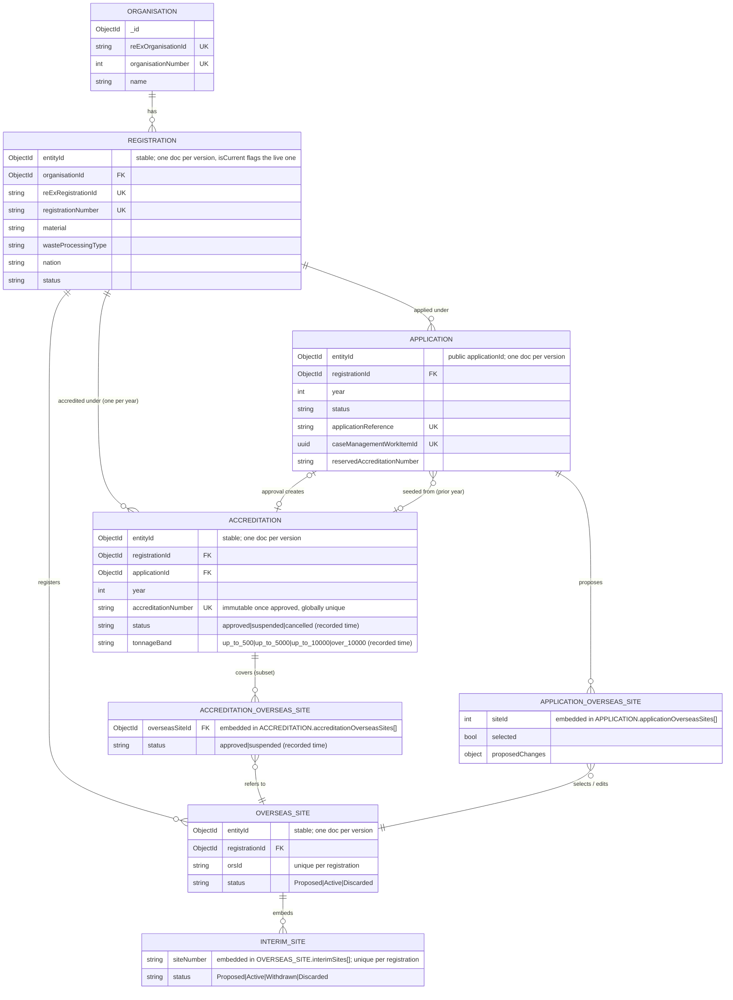
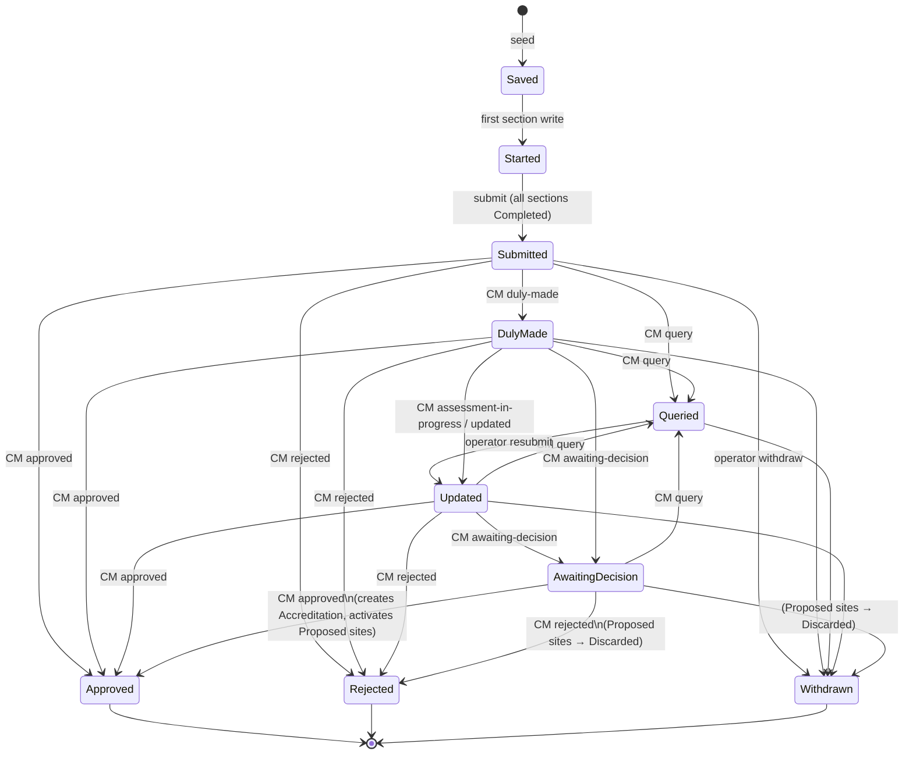
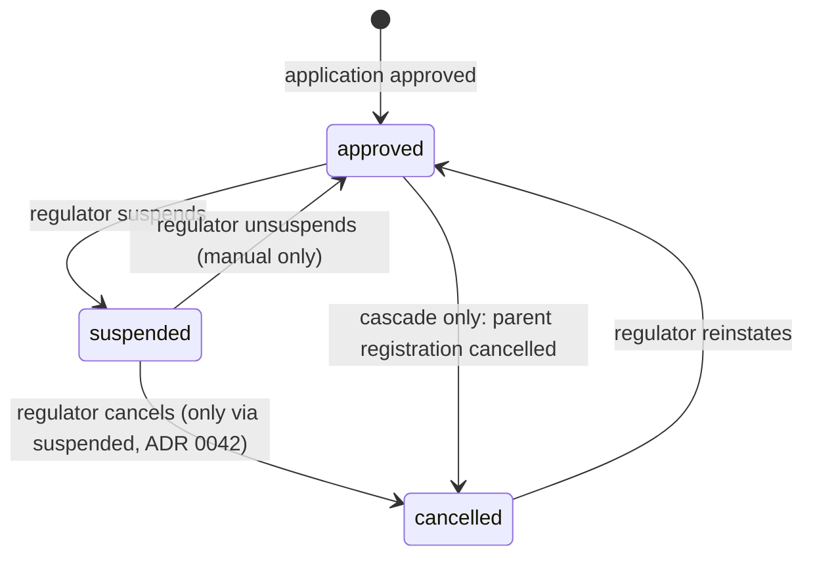
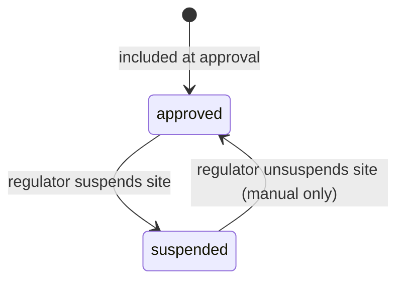
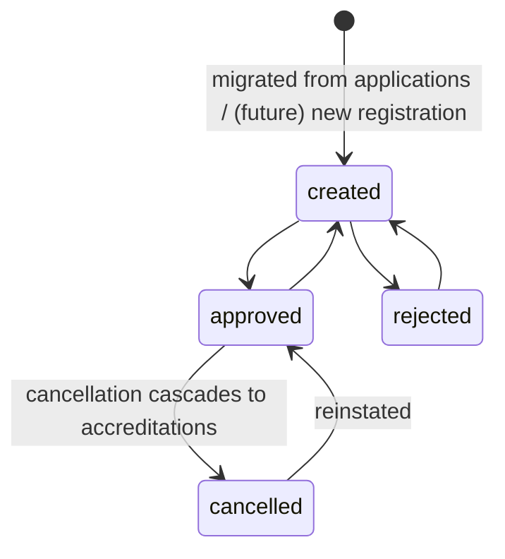
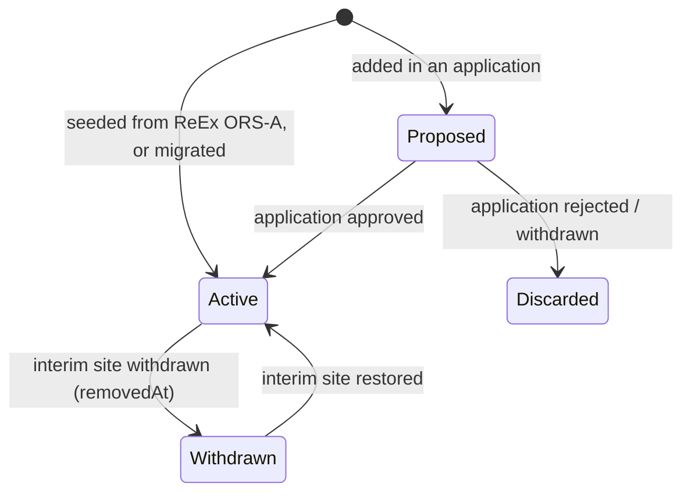

# Register & Enrol backend: splitting the application aggregate into a domain model

**Repo:** `epr-register-enrol-backend` (.NET, MongoDB) · **Baseline:** `origin/main` @ `308f73f` (includes PR #210) · **Status:** draft v6.1, with the 2026 import descoped · **Dates:** v1 2026-10-20, v2 2026-10-21, v3 2026-10-22, v4 2026-10-26, v5 2026-10-26, v6 2026-10-27, v6.1 2026-10-28

**Changes in v6.1 (2026-10-28): phases 0–1 as built, after the PR #219 review**

- **Phase 1 is behind a flag.** `DomainModel:ExpandEnabled` (off by default) builds the empty collections and
  adds the `domain-model-schema` readiness check. The B0/B1 diagnostics flag moved under the same section,
  as `DomainModel:DiagnosticsEnabled` (§6).
- **The readiness check reads a stored result.** The schema is checked at startup, after the collections
  are built; a probe never calls Mongo. If Mongo is briefly unreachable then, the service retries in the
  background with backoff (5 seconds, doubling to at most 5 minutes) until the check passes, so readiness
  recovers without a restart.
- **B1 has a production script:** `tools/domain-model/legacy-data-survey.js`, run with `mongosh` (§6, phase 0).
- **B5's legacy fields are named `registrationEntityId`, `accreditationEntityId` and
  `overseasSites.sites[].overseasSiteEntityId`**, because `registrationId` already holds ReEx's id. No
  `reservedAccreditationNumber` was added: `accreditationReference` already holds it until approval (M2).
- **Nested enums are strings too.** Every class the new collections store, however deeply nested, is the
  domain model's own, not a legacy model class, so changing a legacy class cannot change what they store.
  A test guards this. Legacy enums are still shared, because they are stored by name (§3.1).
- **No-op suppression ignores `source.importedAt`**, wherever it is nested, and compares times as stored (§4.2).
- **Small additions, kept on purpose:** `Accreditation.approvedAt` (the business approval date, which can be
  earlier than the first version's `validFrom`); `Application.reExOrganisationId` and `reExRegistrationId`
  (what the migration uses to find or create the Organisation and Registration before `registrationId` is
  set); and the `domainModelDiagnostics` scratch collection, which B0's smoke test needs because a
  transaction cannot create a collection everywhere. It holds nothing between runs.

**Changes in v6 (2026-10-27): the 2026 import is descoped** (D10)

- **There is one job, the migration (phase 4).** It reshapes the 2027 applications this service holds into
  the new schema, and dual-write keeps them current. The word "backfill" is no longer used for it.
- **No ReEx import.** ReEx already holds the 2026 accreditations and is the primary client of the v2 APIs, so
  nothing in v2 needs 2026 data from this service. It may never be imported.
- **Removed with it:** the import queue, the public-register extract and its report, the natural-key ReEx
  adapter method, enrichment of Registration and Organisation from ReEx, ReEx-sourced Accreditations
  (`source`, `reExAccreditationId`, `reExValidFrom`), the back-dating of status history (Q32, D2a) and the
  `validFromSource` marking. B7a, R16, A27 and A28 are withdrawn.
- **How 2027 Accreditation data arises.** The 2027 applications were seeded from ReEx's 2026 data and most
  have been started. That data stays in the Application as the operator's proposal. An Accreditation is
  created only when an application is approved here. From the next round, seeding comes from this
  service's own Accreditations (A23).
- **Enrichment deferred:** migrated Registrations and Organisations are not enriched from ReEx, because
  the v2 endpoints do not need it today ([Q35](#q35)).

**Changes in v5 (2026-10-26): versioning and migration decisions** (D6–D10, §9.6)

- **History is versioned documents in one collection per entity (option B, D6).** Options A
  (current + `_history`) and C (embedded `versions[]`) are removed. Collections are named
  `registrationVersions`, `overseasSiteVersions`, `applicationVersions` and `accreditationVersions`.
  Every reference between entities holds the stable `entityId`, and every business unique index is a
  partial unique index on `isCurrent: true` (§3.2, §4).
- **Application is versioned too (D6).** Its `entityId` is the existing application `_id`, so the public
  `{applicationId}` does not change. How it relates to the legacy `accreditationApplications` collection
  during migration is open ([Q33](#q33)).
- **Organisation is not versioned (D7).** It is a synced copy, overwritten in place, and may later shrink
  to an Account Management id plus augmenting data.
- **Renames (D8).** The Accreditation's `sites[]` is the **Accreditation Overseas Site**
  (`accreditationOverseasSites[]`), and the Application's `siteSelections[]` is the **Application
  Overseas Site** (`applicationOverseasSites[]`). Both stay embedded.
- **Known limit, accepted (R15):** test-environment results do not prove production data shapes.
- **Migration sequence changed (D9).** No shadow-read phase. Dual-write is **fatal** on failure and now
  comes **before** the migration. Reads and the v2 API go live together once reconciliation is at zero, then
  a soak, then a **cut** of legacy writes, then an archive. Reconciliation must be runnable in test
  environments, and optionally handed to production-access staff (Q34, accepted as R15).
- **The migration is an in-app `BackgroundService` (D10).** It reshapes our 2027 data with no ReEx calls.
  Failures are short Error-level log lines with no personal data. *(The separate 2026 backfill planned in
  v5 was dropped in v6.)*
- **Seeding is a convenience.** The new Application is seeded from the previous year's Accreditation
  and may have gaps the operator fills (§3.2, A23).

**Changes in v4 (2026-10-26): review with Adam** (decisions D1–D5, §9.5)

- **Interim sites are part of their Overseas site (D1).** They are no longer a separate entity or
  collection. They are an embedded `interimSites[]` array on the OverseasSite document, and every
  interim add, edit, withdraw or restore is a new **ORS version**. `siteNumber` keeps its own
  `001`–`999` pool per registration, separate from `orsId` (Q30a), enforced by a multikey unique index
  (§3.2, §4.2). The `interimSites` collection is removed.
- **Tonnage band is part of the Accreditation (D2).** It is a `tonnageBand` field on the Accreditation,
  not a separate entity. Each change is a new Accreditation version, and the API's
  `tonnageBandHistory[]` is projected from those versions, just as `statusHistory[]` is (§4.4). The
  `tonnageBands` collection and its "later owned by Registration" note are removed.
  - ~~Migration back-dates the band with status (D2a).~~ *Withdrawn in v6: nothing is back-dated.*
- **The v2 API reads only the new model (D3).** Its four endpoints don't exist yet. They are built
  only on the new collections and never read `accreditationApplications`. They go live once the migration
  has run and full dual-write (phase 3) keeps the new collections current (§6). The phased
  dual-write, migration, facade and cut plan is still how the **existing** operator and case-management
  endpoints move.
- **No back-dating of this service's approvals (D4).** The migration goes live before approvals in this
  service do. *(v6: nothing is back-dated at all.)*
- **Accreditations are addressed by organisation, registration and year (D5)**, as ReEx asked:
  `/v1/organisations/{organisationNumber}/registrations/{registrationNumber}/accreditations/{year}`.
  `year` is the year the accreditation applies to, not the year it was created or approved.
  `accreditationNumber` is returned but is not a path identifier (§5.3, §6.4).

**Changes in v3 (2026-10-22): the effect of the v2 API YAML** (`docs/openapi/registration-accreditation-api.v2.yaml` and `.v2.mapping.md`)

- ~~Effective-dated status~~ **rejected (Q21)**. Status stays **recorded-time only** (decision 6
  stands). `statusHistory[]` in the API is a projection of the Accreditation's own history, and the v2
  YAML's `effectiveDate` must be removed (§4.4).
- General back-dated import **dropped (Q22)**. *(v3 allowed migration to back-date status history, Q32;
  withdrawn in v6.)*
- Ids: ORS and interim sites keep **separate** 001–999 pools (Q30a). Legacy `SN-000N` interim numbers
  are checked in production data and, if any exist, **renumbered once** to 3 digits (Q30b).
- **Tonnage band** becomes its own temporal entity, with recorded-time history only (§3.2).
  *(Superseded in v4: the band is a field on the Accreditation, D2.)*
- **Interim sites on an accreditation** are their ORS's interim sites. `removedAt` means removed from
  the ORS (Q24), so no per-accreditation membership is needed.
- **Basel/OECD codes** are stored and exposed as a list (`baselOecdCodes[]`), replacing `code1`–`code3`.
- **Signatory `phone`** stays empty for now (Q25).
- **Site ids are stable across years (Q26 answered, requirement A22).**
  - The 3-digit ORS `orsId` and interim site `siteNumber` (`001`–`999`) are the site identities. They
    are allocated per registration, carried into every later application and accreditation, and never
    reissued.
  - Only new sites get new numbers.
  - The int `siteId` is internal only.
- **Seeding comes from this service's own model once it owns the data (A23).** Sites carry over year
  to year, and each new application starts from the previous year's Accreditation for what to include
  or exclude. ReEx is used for bootstrap only (§3.2, B24, [Q31](#q31)).
- **Signatories** and the **business plan** are owned by the Accreditation; the business plan is not exposed.
- The **validity API probably folds into** `GET /v1/organisations/{organisationNumber}/registrations/{registrationNumber}/accreditations/{year}` (§6.4).
- New §5.3 maps every v2 YAML element. §5.2 (v0.1) is kept as superseded history.

**Changes in v2**

- ~~Imported history may be back-dated (A6 revised, §4.3).~~ *Withdrawn in v6.*
- ~~ReEx accreditations are imported by backfill, not at seed (A11 refuted).~~ *No import in v6 (D10).*
- Organisation is a **synced copy**, never mastered here (Q1).
- Accreditation and Registration lifecycles **follow ReEx**, including cancellation and the
  registration-to-accreditation cascade (Q3, Q4).
- A new **accreditation-validity API for ReEx** (Q2).
- Interim sites are suspended **with their ORS**, not on their own (Q5, Q6).
- Accreditation numbers **never change** after approval (Q7).
- An old registration number **still resolves**, to the last version that carried it (Q10).
- Sampling plan and recycling process are **kept but not exposed** (Q11).
- Unsuspension is **manual only** (Q14).
- The PR #210 YAML is a **draft under review**, so §5.2 is input to that review, not a target.

Paths below are relative to the backend repo unless they name another repo. "App" means
`AccreditationApplication/Models/AccreditationApplicationModel.cs` and its section classes.

---

## 1. Summary

Today the backend persists **one aggregate**: a document in `accreditationApplications`, one per
(ReEx organisation, ReEx registration, material, year) application attempt. Organisation, Registration
and Accreditation are **not stored**. They are read live from ReEx at seed time and copied, as flattened
and partly formatted values, onto the application. ORSs and Interim Sites live only inside
`overseasSites.sites[]` of each application. Approval only flips `applicationStatus`, and no accreditation
record is created.

This plan:

- Introduces four versioned entities, **Registration, OverseasSite (ORS), Application and
  Accreditation**, plus a synced, **unversioned** Organisation. Each versioned entity has one
  `*Versions` collection holding all its system-time versions (v5). Interim sites are embedded in their
  ORS, and the tonnage band is a field on the Accreditation (v4).
- Slims **Application** down to the operator's proposal plus case-processing state.
- Adds an **Accreditation**, created atomically when the approval push arrives. It becomes the source
  of truth that **ReEx queries** to decide whether PRNs may be issued (Q2).
- Implements history as **versioned documents in one collection per entity** (`isCurrent`, `validFrom`,
  `validTo`), written in one multi-document transaction. This is the closest Mongo equivalent of a SQL Server system-versioned temporal table.
- Migrates **expand → seed dual-write → full dual-write → migrate and reconcile → switch reads (and v2 API go-live) →
  cut → archive**. Each step is behind a flag and reversible **until the cut** (phase 6), after which rollback loses data. The existing endpoints keep
  their exact JSON throughout, served first from the legacy document and later from a read-model facade.
- Builds the **v2 Accreditation API** (four read endpoints, not yet live) on the new collections only.
  It goes live after the migration and full dual-write, and never reads the legacy document (v4, D3).

The hardest constraint is not the data. It is that **the stored document is the wire contract**: every
existing GET and PATCH returns `AccreditationApplicationModel` verbatim. The Mongo `_id` hex is also a
public identifier, in frontend URLs and in management-be's long-lived `workItems.payload.operatorApplicationId`.
The plan therefore keeps `accreditationApplications._id` as the Application's identity forever (it becomes the `entityId` in `applicationVersions`), and gates
every read switch on golden-JSON equality.

---

## 2. Current state

### 2.1 Stored collections

| Collection | Model | Notes |
| --- | --- | --- |
| `accreditationApplications` | `AccreditationApplicationModel` | The aggregate. Persistence and indexes: `AccreditationApplication/Services/AccreditationApplicationPersistence.cs:13-343` |
| `recyclingOperationsAudit` (via `RecyclingOperationsAuditPersistence`) | `RecyclingOperationsAuditRecord` | Before and after operation codes for the regulator correction endpoint only (RA-469) |
| `regulatoryNumberSequences` | `RegulatoryNumberSequenceCounter` | 16 counter pools for R- and A- numbers (RA-448) |
| `stubAccreditationApplications` | `StubApplicationDocument` | Frontend stub mode only: an opaque `BsonDocument Data` (`StubPersistence/Models/StubApplicationDocument.cs`) |
| pending uploads, CM auth nonces | `PendingUploadDocument`, `CaseManagementAuthNonceDocument` | Infrastructure, out of scope |

`Organisation/Models/OrganisationModel.cs` (`OrganisationModel`, `RegistrationModel`, `AccreditationModel`)
is **a ReEx-shaped test fixture, not a stored model** (`Organisation/Services/FakeOrganisationPersistence.cs`).
PR #210's mapping already says so (`docs/openapi/registration-accreditation-api.mapping.md:19`).

Driver conventions (`Utils/Mongo/MongoDbClientFactory.cs`): camelCase names, `IgnoreIfNull`, and
`IgnoreExtraElements`. The last one makes **additive fields safe**, because older code ignores them. Enums
without `[BsonRepresentation]` are stored as int32 (`sectionStatus`, `plannedTonnageBand`, `scanStatus`, `documentType`).

Topology: tests run a **single-node replica set**, commented as "closest match to the CDP"
(`EprRegisterEnrolBackend.Test/TestSupport/MongoIntegrationFixture.cs:38-41`), so multi-document
transactions are available in deployed environments. Local `compose.yml:34-43` runs a **standalone**
`mongo:6.0.13`, so transactions fail locally today.

### 2.2 The seeding path

`POST api/v1/accreditation-applications/{organisationId}/{registrationId}/{materialType}/seed`
(`AccreditationApplicationEndpoints.cs:670-814`):

1. An idempotency check through `GetLiveByRegistrationAsync` (non-withdrawn, newest first). This is
   best-effort only: there is no unique index, so a race can create a second live application
   (comment at lines 703-714). That is a defect, never a valid state: there is at most one live
   application per organisation, registration and year.
2. `HttpReExApiAdapter.GetAccreditationAsync(org, reg, material, year - 1)`
   (`AccreditationApplication/Adapters/HttpReExApiAdapter.cs:53-373`) fetches the whole ReEx organisation,
   picks the registration by ReEx `id`, and follows `registration.accreditationId` to **one** ReEx
   accreditation, whose `validFrom.Year` must equal `year - 1`. For exporters it calls ORS-A
   (`GetOverseasSiteAsync`), and `MapOverseasSite` (lines 500-534) sets `Selected = validFrom != null`.
3. It builds the application from the prior-year data, including the formatted address strings, and
   inserts it with status `Saved`.

The ReEx DTOs are in `ReEx/Dtos/OrganisationDto.cs` and `ReEx/Dtos/OverseasSitesDto.cs`.
`RegistrationBaseDto` carries `id`, `accreditationId` (one only), `registrationNumber`,
`submittedToRegulator`, `noticeAddress`, `wasteManagementPermits` and `glassRecyclingProcess[]`; the
reprocessor and exporter subtypes add site or ORS data.

### 2.3 Existing endpoints (must keep working)

Route table: `AccreditationApplication/Endpoints/AccreditationApplicationEndpoints.cs:33-208`, all under
`api/v1/accreditation-applications`.

| Caller | Routes |
| --- | --- |
| Frontend (shared-secret, `FrontendOnly`) | `…/seed`; `GET {org}`; `GET {org}/{app}`; `PATCH prns`, `tonnage`, `business-plan`, `sampling-plan`, `overseas-sites`, `bes-evidence`; `POST overseas-sites`; `PATCH overseas-sites/{siteId}`; `POST …/promote`, `…/revert`; `POST …/interim-site` (legacy) and `…/interim-sites`; `PATCH`/`DELETE …/interim-sites/{interimSiteId}`; `POST …/restore`; BES evidence file `POST`/`PATCH`/`DELETE`; `submit`, `resubmit`, `withdraw`; `files`, `files/initiate`, `files/bes-evidence/initiate`, `files/{id}/status` |
| Case management (HMAC, `CaseManagementAuthenticationHandler`) | `case-management/{workItemId}/query`, `case-management/{workItemId}/status`, `{org}/{app}/registration-number`, `{org}/{app}/accreditation-number`, `{org}/{app}/overseas-sites/{siteId}/recycling-operations` |
| CDP uploader | `files/upload-completed` |
| Other | `api/v1/organisations/{organisationId}/defra-link` (`Organisation/Endpoints/ReExOrganisationEndpoints.cs:15-23`); `api/v1/stub/accreditation-applications` (`StubPersistence/Endpoints/StubApplicationEndpoints.cs:16-20`) |

Behaviours the facade must preserve:

- GET, PATCH and status responses return the **whole model** (`Results.Ok(application)`, e.g. `:830`, `:916`, `:3408`).
- `{applicationId}` is the Mongo `_id` hex (`AccreditationApplicationPersistence.cs:121-126`).
- Application status transitions:
  - Saved → Started on the first section write (`:972`, `:1033` …)
  - Started → Submitted (`:2614-2639`)
  - Queried by the query push (`:3068`), then Queried → Updated on resubmit (`:2743-2747`)
  - CM states mapped in `MapCaseManagementStateToApplicationStatus` (`:3232-3243`)
  - approve or reject only from Submitted, Updated, DulyMade or AwaitingDecision (`:3356-3378`)
  - Withdraw only from Submitted, DulyMade, Queried, Updated or AwaitingDecision (`:3420-3443`)
  - Approved, Rejected and Withdrawn are terminal (`RejectIfTerminal`, `:231-239`)
- Accreditation and registration numbers are minted on the **application** (`:309-470`). An accreditation
  number needs a registration number first (`:408-411`). Regenerate ("reapply") increments YY in place (`:618-627`).
- ORS id allocation scope is **every application under the same `RegistrationId`**
  (`AccreditationApplicationPersistence.cs:87-114`, `Services/OrsIdGenerator.cs`). Interim site numbers use
  the same scope and include withdrawn sites. Both are guarded by conditional replace
  (`UpdateIfOrsIdAbsentAsync`, `UpdateIfInterimSiteNumberAbsentAsync`).
- Concurrency:
  - `version` optimistic replace (RA-516, `:207-239`)
  - targeted `$set` with guard filters for Resubmit and Withdraw (RA-519, `:266-293`)
  - the `caseManagementStatusUpdatedAt` ordering watermark (RA-368)
- `versions[]` per section are **submission snapshots** taken on Submit and Resubmit. They are not
  entity history and must not be confused with it.

### 2.4 PR #210 (merged, documentation only)

- `docs/openapi/registration-accreditation-api.yaml`: a read-only API. It covers organisations, nested
  registrations, registered ORS and interim sites, accreditations by year or reference, applications
  under an accreditation, accredited ORS and interim sites, and the `/registrations` and `/accreditations`
  searches. All path ids are business references.
- `docs/openapi/registration-accreditation-api.mapping.md`: traces each API field to C# and Mongo. It
  states openly that the Organisation, Registration and Accreditation columns describe the fixture,
  because "the real source is ReEx until the data remodel" (`:305-306`). **This plan is that remodel.**
- **The YAML is an initial draft under review and is expected to change.** This plan therefore designs the
  model for the use cases the YAML expresses, rather than for its exact shapes. §5.2 lists the points the
  review should settle.

**v2 draft (after architecture review; untracked in the backend checkout at the time of writing):**
`docs/openapi/registration-accreditation-api.v2.yaml` (0.2.0-draft) and `registration-accreditation-api.v2.mapping.md`.

- **Accreditation is the only exposed resource**, under four read paths:
  - `GET /v1/accreditations?year=` (search; summaries only)
  - `GET /v1/organisations/{organisationNumber}/registrations/{registrationNumber}/accreditations/{year}` (with status history and tonnage band history)
  - `GET /v1/organisations/{organisationNumber}/registrations/{registrationNumber}/accreditations/{year}/overseas-sites`
  - `GET /v1/organisations/{organisationNumber}/registrations/{registrationNumber}/accreditations/{year}/overseas-sites/{orsId}`
- Interim sites appear inline in their ORS. Organisation, Registration and Application are internal only.
- The first consumer is ReEx.
- The changes it makes to the domain model are covered in §3.2, §4.4 and §5.3.

### 2.5 Consumer-facing effects found (design for these is out of scope; listed as required)

From read-only sweeps of the sibling repos. Each item affects facade fidelity or a later contract phase.

**epr-register-enrol-frontend**

- F1. Every backend call goes through `src/server/common/helpers/accreditationApiService.js`.
  `normalizeApplication` (lines 99-176) is the single mapping point.
- F2. Fields read: `id`, `organisationId`, `orgId`, `registrationId`, `applicationStatus`,
  `applicationReference`, `submitterContactDetails`, `prns.authorisers`, `overseasSites`, `besEvidence`,
  `query`, `dueDate`, `materialType`, `year`, `siteAddress`, `companyRegisteredAddress`, `createdAt`,
  `nation` (`paymentDetails.js:77`) and `notificationStatus`.
  - Site-level: `selected`, `isNewSite`, `registeredNowAccredited`, `orsId`.
  - `interimSites` with a **fallback to the singular `interimSite`** (`common/helpers/interimSites.js:27-30`).
- F3. **References are muddled.**
  - The UI's `accreditationReference` is `applicationReference ?? accreditationReference` (lines 124-125),
    so the real A-number never reaches the UI.
  - The UI's `registrationReference` is `registrationId ?? wasteRegistrationNumber` (lines 152-153). That is
    the ReEx id, not the R-number.
  - The backend's `SubmitResponse.AccreditationReference` actually carries the `ApplicationReference`
    (`AccreditationApplicationEndpoints.cs:2611,2726`).
- F4. The `_id` hex appears in URLs (`/accreditation/task-list/{applicationId}`). `accreditationSelection.js:95-110`
  picks one application per (registrationId, material, year) and breaks ties by comparing ObjectId hex.
- F5. `application.organisation?.accreditation` (`operator-accreditation/controller.js:~57`) exists only in
  stub data.

**epr-register-enrol-management-be**

- M1. Calls `case-management/{workItemId}/query|status`, `accreditation-number` and `recycling-operations`.
  It never calls `registration-number`.
- M2. **It mints the accreditation number before pushing `approved`**, because the backend refuses to mint
  once the application is terminal (`ReAccreditationLogDecisionService.cs:207-239`; verified). Decisions
  are pushed only from `awaiting-decision`.
- M3. Stores a BSON snapshot of the submitted document in `workItems.payload`:
  - `operatorApplicationId` is the backend `_id` (`ReAccreditationPayload.cs:80-92`)
  - `operatorOrganisationId` is the ReEx org id
  - it also holds `overseasSites.sites[]`, both interim shapes, and other fields
  - its own migrations depend on that shape (`ReAccreditationInterimSitesBackfillMigration.cs`)
- M4. `recycling-operations` returns the site JSON, which management-be patches into its copy, matching
  `siteId` as an int or a string (`ReAccreditationEndpoints.cs:1292-1328`).

**epr-register-enrol-management-fe**

- MF1. No direct backend calls, but it renders the payload copy: `orsId`, `registeredNowAccredited`,
  `isNewSite`, `interimSites` with the singular fallback, and `authorisers[].isNew`.
- MF2. `recycling-operations.controller.js:81-94` reads **only the singular `interimSite`**.
- MF3. `work-items/re-accreditation/create/schema.js:80-84` expects `operatorOrganisationId` to be 6 digits.
  Real submissions send the ReEx id, which is a pre-existing mismatch.

**epr-register-enrol-fe-tests / epr-register-enrol-mgmt-tests**

- T1. fe-tests calls the backend directly and asserts raw JSON:
  - `isNewSite`
  - singular `interimSite` (`interim-site.e2e.js:79-93`)
  - `interimSites`
  - `caseManagementWorkItemId`
  - `prns`
  - `besEvidence`
  - list `applicationId`, `applicationStatus` and `year`
  - it pushes `toStateId` values without HMAC, relying on the dev bypass
- T2. mgmt-tests stubs the backend (`docker/stubs/operator-backend-stub.mjs`). Neither suite writes to the
  backend's Mongo.

**Not read by any consumer:** `previousRegistrationNumbers`, `previousAccreditationNumbers`, `versions`,
`caseManagementWorkItemId` (outside tests), and `validFrom`. These are safe to move without facade gymnastics.

---

## 3. Target domain model

### 3.1 Principles

- **Internal identity is a Mongo `_id` per entity.** Business references are attributes that can change
  (numbers are regenerated) and so are never used as keys. Their changes are captured in history.
- **ReEx ids are kept as source keys** (`reExOrganisationId`, `reExRegistrationId`),
  so seeding is idempotent and the existing route segments still resolve.
- **Enums are stored as strings** in all new collections. This drops the int32 transform PR #210 had to document.
  It includes enums nested in the Application's sections, so the domain model has its own section types
  rather than reusing the legacy ones. `tonnageBand` is stored as ReEx's value, such as `up_to_5000` (D2),
  and serialised to JSON as the same value.
- **An Application is a proposal.** It references the registration and records the operator's proposed
  selection and changes. It never owns registration-level truth.
- **Accreditation reaches Organisation only through Registration** (fixed decision 3). It has no
  `organisationId`.
- **Identity rule (v5): only `entityId` crosses a boundary.** A version's `_id` changes on every write, so
  it is internal and never leaves the service. Every id in a URL, response body, header (including
  `Location`), event, work-item payload or message to another service is an `entityId` or a source key.
  - The Application's public `{applicationId}` is its `entityId`, which equals the legacy `_id` (Q33), so
    existing URLs and management-be's `operatorApplicationId` keep resolving.
  - The route `{organisationId}` and management-be's `operatorRegistrationId` stay **ReEx's** ids
    (`reExOrganisationId`, `reExRegistrationId`), never our `entityId`s (R8).
  - Lookups by id go through the repository on `entityId` and `isCurrent`, never `find({_id})` on a
    `*Versions` collection.
  - Any id a service stores about another service's entity (for example management-be about an
    Accreditation) is that entity's `entityId`.

### 3.2 Entities

| Entity (collection) | Identity | Key fields | Relationships | Owner / writer |
| --- | --- | --- | --- | --- |
| **Organisation** (`organisations`) | `_id`; unique `reExOrganisationId`; unique sparse `organisationNumber` (int, ReEx `orgId`) | `name`, `tradingName`, `companyRegistrationNumber`, `companiesHouseNumber`, `registeredAddress` (structured), `address` (fallback, structured), `businessType`, `partnership`, `contactDetails`, `managementContactDetails`, `submitterContactDetails`, `users[]`, `wasteProcessingTypes[]`, `reprocessingNations[]`, `submittedToRegulator`, `linkedDefraOrganisationId`, `source{system, importedAt, reExSchemaVersion}` | 1 → n Registration | **Never mastered here (Q1).** ReEx is master today; **Account Management** will be later. This service holds a **read-only synced copy**, changed only by import or sync, and it is **not versioned**: a sync overwrites it in place, with no history collection. When Account Management becomes the source of truth, this collection may shrink to the Account Management id plus any data we augment it with. The sync mechanism is [Q15](#q15) |
| **Registration** (`registrationVersions`) | `entityId` (stable; what other entities reference); `_id` per version; current-version unique `reExRegistrationId`; current-version unique sparse `registrationNumber` | `organisationId` → Organisation; `registrationNumber`, `previousRegistrationNumbers[]`; `status` (**ReEx's lifecycle**: created, approved, rejected, cancelled; §3.4); `wasteProcessingType` (reprocessor or exporter); `material`; `glassRecyclingProcess`; `nation` (from `submittedToRegulator`); `site{address, gridReference, siteId}`; `noticeAddress`; `wasteManagementPermits[]`; `recyclingProcess[]`; `exportPorts[]`; `yearlyMetrics[]`; `approvedPersons[]`; `contactDetails`; `submitterContactDetails`; `samplingInspectionPlan[]`; `suppliers`; `plantEquipmentDetails`; `formSubmissionTime` | n → 1 Organisation; 1 → n ORS; 1 → n Accreditation (one per year, see [A4](#assumptions)); 1 → n Application | Synced from ReEx **until** this service implements new registrations and registration fee payments (Q1). After that it is mastered here. Registration numbers are minted here (moved from Application) |
| **OverseasSite / ORS** (`overseasSiteVersions`) | `entityId` (stable); `_id` per version; current-version unique (`registrationId`, `orsId`). **`orsId` is the stable, user-visible identity** (A22): 3 digits, allocated once per registration, kept across years and never reissued | `orsId` ("001"–"999"), `siteName`, `address{line1, line2, town, country}`, `formattedAddress`, `country`, `isEu`, `isOecd`, `coordinates`, `contact{fullName, email, phone}`, `operationCodes[]` (R-codes), `baselOecdCodes[]` (Basel/OECD waste codes, as an ordered list; a maximum of 3 is a validation rule, not the storage shape; empty for sites seeded from ReEx), `repatriatedLoads`, `conditionsOfExport`, `status` (Proposed, Active, Discarded), `origin` (ReEx or Operator), `proposedByApplicationId`, **`interimSites[]`** (embedded, v4; see the next row) | n → 1 Registration; embeds 0..n interim sites | Registration-scoped. Operator-proposed until its application is approved |
| *Interim site* (**embedded** in `overseasSites.interimSites[]`; no collection of its own, v4 D1) | No `_id`. **`siteNumber` is the stable identity** (A22): 3 digits from its own per-registration pool, separate from ORS ids ([Q30](#q30)), kept across years. Uniqueness across the registration comes from a **multikey unique index** on the ORS collection (§4.2). Legacy `SN-000N` values are renumbered once if the survey finds any ([Q30](#q30)) | `siteNumber`; `previousSiteNumbers[]`; `siteName`; `address{line1, line2, town, region, country, postcode}`; `contact{…}`; `operationCodes[]` (R12/R13 mandatory); `status` (Proposed, Active, Withdrawn, Discarded); `proposedByApplicationId`; `createdAt`; `removedAt` | Part of its ORS | Same as ORS. **No suspension of its own (Q5).** It can only be removed from its ORS (`removedAt`, status Withdrawn) or restored (RA-603). **Every change is a new version of its ORS**, so its history is the ORS's history. It appears on every accreditation that covers its ORS, and is suspended implicitly when that ORS is (Q6) |
| **Application** (`applicationVersions`; the legacy `accreditationApplications` stays the source of truth for writes until phase 6, §6) | `entityId` = the existing application `_id`, so the public `{applicationId}` is unchanged; `_id` per version; current-version unique sparse `applicationReference` | `registrationId` → Registration (new FK); `year` (accreditation year applied for); `sourceAccreditationId` → Accreditation (prior year); `status`; `paymentReference`; `caseManagementWorkItemId`; `caseManagementStatusUpdatedAt`; `submittedBy`; `withdrawalReason`; `dateSent`; `dateLastEdited`; `query`; sections (`prns`, `businessPlan`, `samplingPlan`, `besEvidence`, `overseasSites`), each with `sectionStatus` and submission `versions[]`; `applicationOverseasSites[]`; `reservedAccreditationNumber` | n → 1 Registration; 0..1 → 1 Accreditation (`accreditationId`, set on approval) | This service. Operator via frontend; case management via pushes |
| **Accreditation** (`accreditationVersions`) | `entityId` (stable); `_id` per version; current-version unique `applicationId`; current-version unique `accreditationNumber`, **globally unique** across organisations (v2 assumption, A20); current-version unique (`registrationId`, `year`) | `registrationId` → Registration (**only** link upward); `year` (the year the accreditation **applies to**, not the year it was created or approved; part of the API path, D5); `accreditationNumber` (**immutable once approved**, Q7); `status` (approved, suspended or cancelled; **stored, recorded-time only**, Q21; history via §4.2, with the API's `statusHistory[]` projected from it, §4.4); `periodStart`/`periodEnd` (business validity, **not** history); `signatories[]` {fullName, email, phone?} (was `prnIssuance.authorisers`); `businessPlan{…}` (**owned, not exposed**, v2); `samplingPlanFiles[]` (refs; **kept, not exposed**, Q11); `recyclingProcess[]` (**kept, not exposed**, Q11; source to be confirmed); `accreditationOverseasSites[]` (an **Accreditation Overseas Site**) = {`overseasSiteId`, `orsId`, `status` (approved or suspended; same rules), `besEvidence[]`}. The interim sites of an accredited ORS are **that ORS's embedded interim sites**, with no separate per-accreditation membership (Q24); `tonnageBand` (v4 D2: `up_to_500`, `up_to_5000`, `up_to_10000` or `over_10000`, which are ReEx's `TONNAGE_BAND` values; **stored, recorded-time only**, A19; each change is a new Accreditation version with `lastChange.reason = TonnageBandChanged`, and the API's `tonnageBandHistory[]` is projected from those versions, §4.4; it is on the public register) | n → 1 Registration; 1 → 1 approving Application; references ⊆ the registration's ORSs (and so their embedded interim sites) | This service. Created by the approval push only. ReEx already holds earlier accreditations and is the primary consumer of this API, so none are imported (D10). Suspended, cancelled and reinstated manually by the regulator (Q14). **Read by ReEx** through the v2 API (Q2). The first `tonnageBand` comes from the application's `prns.plannedTonnageBand`; later values come from in-year changes |

**Versioned collections (v5, option B).** Registration, OverseasSite, Application and Accreditation each
live in **one `*Versions` collection** (`registrationVersions`, `overseasSiteVersions`,
`applicationVersions`, `accreditationVersions`). Every version is a document, and the current version
has `isCurrent: true` (§4). Organisation is **not** versioned (Q1).

- `entityId` is the stable identity. Every reference between entities (`registrationId`,
  `overseasSiteId`, `applicationId`, `accreditationId`, `sourceAccreditationId`) holds an `entityId`,
  never a version `_id`.
- Every "unique" index above is a **partial unique index on `isCurrent: true`**, because business keys
  repeat across versions.
- The embedded arrays are named after their owner: an **Accreditation Overseas Site**
  (`accreditationOverseasSites[]`, was `sites[]`) and an **Application Overseas Site**
  (`applicationOverseasSites[]`, was `siteSelections[]`). The Application's existing `overseasSites`
  section (status and submission `versions[]`) is a different thing and keeps its name.

`applicationOverseasSites[]` on Application is one entry per site the application touches:

- `siteId`: the existing per-application int, kept so `{siteId}` routes still resolve
- `overseasSiteId`
- `selected`, `isNewSite`, `registeredNowAccredited`
- `proposedChanges`: an overlay of ORS fields edited in this application
- `previousSites`: the undo stack
- `besEvidence{uploads[], doYouWantToUploadMoreEvidence}`
- `interimSites[]` = {`legacySiteId`, `siteNumber`, `isNewSite`, `proposedChanges`}. An embedded interim
  site has no `_id`, so the selection refers to it by `siteNumber` within the selection's ORS (v4)

#### Carrying sites across years (A22)

Today each year's application is seeded only from ReEx ORS-A, so:

- **ORSs registered in ReEx** keep their 3-digit ids.
- **Operator-added ORSs from an earlier year are lost** unless ReEx has them by then.
- **Interim sites are never carried over**, because ReEx has no interim-site data.

In the target, ORSs and interim sites live on the Registration. **Once this service owns the data,
seeding no longer calls ReEx at all.** A new year's application is built from this service's own model:

| Seed element | Source (target) |
| --- | --- |
| Site list | The Registration's **Active** ORSs and their **Active** embedded interim sites, with their existing `orsId` and `siteNumber` |
| Include or exclude (pre-selection) | The **previous year's Accreditation** for the same registration: sites on it are pre-selected and the rest are not. Sites suspended there are included and **flagged** (`carriedOverStatus`). A cancelled previous-year Accreditation is still the starting point (working assumption). With **no** previous-year Accreditation, nothing is selected ([Q31](#q31)) |
| Other prefill (tonnage band, signatories, business plan) | **Prefilled** from the previous year's Accreditation, replacing today's ReEx `prnIssuance` mapping (Q31c) |
| `sourceAccreditationId` | The previous year's Accreditation `_id` |

Seeding is a **convenience for operators**: it may not carry everything, and the operator may have gaps to
fill. The new world seeds an **Application** (from the previous year's Accreditation), where the old world
seeds an `AccreditationApplication`. This is first a 2026 to 2027 change. Seeding 2027 to 2028 may still
happen, but it will not come from ReEx.

Only a site the operator adds gets a new number from the registration's pool. A number is never
reissued, including after withdrawal or discard.

**ReEx's seed role shrinks over time.** The 2027 applications were seeded from ReEx's 2026 data, and the
migration keeps that data as each application's content. This service holds **no 2026 Accreditation**
(D10), so `sourceAccreditationId` is null for them. Once an Accreditation exists here (from the first
approval), `HttpReExApiAdapter.GetAccreditationAsync` is no longer on the seed path for that registration.

#### Why proposed changes are an overlay, not a write-through

An operator who edits an existing ORS in an application that is then rejected or withdrawn must not
change the registration. So:

- **New** ORSs and interim sites are created on the Registration immediately with status **Proposed**.
  A new ORS is a new `overseasSiteVersions` entity. A new interim site is a new entry in its ORS's
  `interimSites[]`, written as a new ORS version (v4). Either way the `orsId` or `siteNumber` is
  reserved through a unique index, replacing today's scan of every application under the registration.
  - Because a Proposed interim site makes a new version of an Active ORS, every as-of or current read of
    an ORS for an accreditation filters its interim sites to Active (plus Withdrawn under
    `includeWithdrawn`), never Proposed or Discarded.
- **Edits to existing** sites live in `proposedChanges` and are applied to the ORS, as a new history
  version, when the application is approved.
- On rejection or withdrawal, Proposed sites become **Discarded**. They are retained, and their numbers
  stay claimed, which matches today's behaviour for withdrawn interim sites (RA-603).
- Regulator corrections through `recycling-operations` write to the application overlay. See [A7](#assumptions).

### 3.3 ER diagram



### 3.4 State machines

**Application.** The statuses and transitions are unchanged from today, with approval gaining a side effect.



**Accreditation.** This adopts ReEx's lifecycle (Q3), from `epr-backend` `src/domain/organisations/status.js`,
`VALID_ACC_TRANSITIONS`, and ADR 0042.

- ReEx's `created` and `rejected` states belong to the **Application** here, because an Accreditation
  exists only after approval.
- ReEx's `approved → created` edge has no equivalent. Reopening a decided application is not a flow in
  this service.
- Every transition is a manual regulator action (Q14). Nothing expires a suspension automatically.



`approved` and `suspended` together are ReEx's `ACTIVE_ACCREDITATION_STATUSES`: the accreditation exists
and is in force or paused. Only `approved` is **valid for PRN issuance** (Q2).

**ORS within an Accreditation** (`accreditationVersions.accreditationOverseasSites[].status`). It is independent of the
accreditation's own status ([A2](#assumptions), confirmed). The interim sites under a suspended ORS are
suspended **implicitly** for that ORS (Q6), because an interim site has no status of its own on the
accreditation. An interim site can only be removed from its ORS or restored (Q5). **`removedAt` means
removed from the ORS** (Q24, answered). That is the embedded interim site's `status = Withdrawn` (RA-603), and v2 returns
it inline under `includeWithdrawn`. There is no separate "removed from this accreditation" fact.

The state diagrams in this section describe **legal transitions**. Since v3 (§4.4), they are checked
along the **effective-date order** of the status timeline, not just against the latest entry recorded.



**Effective validity**, as the ReEx validity API returns it (§6.4):

| Question | Valid when |
| --- | --- |
| Is the accreditation valid at time `t`? | the Accreditation version in force at `t` (§4.2 as-of query) has `status = approved` |
| Is the ORS valid at `t`? | the above **and** `accreditationOverseasSites[orsId].status = approved` in that same version |
| Is the interim site valid at `t`? | the above for its ORS **and**, in the ORS version in force at `t`, the embedded interim site is `Active` |

All of these are recorded-time (Q21). A change takes effect when it is recorded. For "now", read the
current documents.

**Registration.** This also adopts ReEx's lifecycle (Q4), from `VALID_REG_TRANSITIONS`. Registrations
**cannot be suspended** (PAE-1705).



**Cascade (Q4, ReEx rule):** cancelling a Registration **force-cancels its accreditations** in the same
transaction. This bypasses the "cancelled only via suspended" rule, exactly as ReEx does. Each cascaded
accreditation version records `lastChange.reason = RegistrationCancelled`. Which accreditations are
affected: only **in-force** accreditations (approved or suspended, period not ended). Reinstating the
registration does not reinstate them; each is reinstated manually (Q16).

**ORS on the Registration, and each interim site embedded in it** (lifecycle of the registered site
itself; each `status` is held separately, the interim one on its `interimSites[]` entry):



`Withdrawn` applies to interim sites only, matching RA-603. Whether an ORS itself can be withdrawn from a
registration is still open ([Q5](#q5), second part).

---

## 4. History design in MongoDB

The goal is SQL Server system-versioned temporal table behaviour for Registration, ORS (including its
embedded interim sites), Application and Accreditation (including its tonnage band). Organisation is
**not** versioned (Q1: a synced copy, overwritten in place):

- one **current** version per entity
- closed prior versions with `[validFrom, validTo)`
- `FOR SYSTEM_TIME AS OF t`
- `FOR SYSTEM_TIME ALL`

Time is the **recording time** (fixed decision 6).

### 4.1 Decision: versioned documents in one collection (v5)

Each versioned entity has **one collection holding every version of it**, named `<entity>Versions`
(`registrationVersions`, `overseasSiteVersions`, `applicationVersions`, `accreditationVersions`).

| | How it works |
| --- | --- |
| Shape | Every version is a document `{_id, entityId, version, validFrom, validTo, isCurrent, lastChange, …}`. `entityId` is the stable identity, and `_id` identifies one version |
| Current version | `isCurrent: true`, `validTo` = the sentinel `9999-12-31T23:59:59.999Z` (as a SQL Server temporal table does for its current rows) |
| Write | One transaction: close the old version (`isCurrent = false`, `validTo = now`, matched on `version`), then insert the new one |
| Atomicity | Multi-document transaction (replica set) |
| Current read | Filter `isCurrent: true` on every query. Business unique constraints are **partial unique indexes** on `isCurrent: true` |
| As of `t` | One find: `entityId`, `validFrom ≤ t`, `validTo > t`. Sets work the same way on their foreign key, with no `$unionWith` |
| All versions | One find on `entityId`, sorted by `version` |
| References | Other entities hold the **`entityId`**, never a version `_id` |
| Reporting | One plain collection per entity, easy to export |

What this costs, and is accepted:

- Every query in the codebase that reads these entities must filter on `isCurrent: true` (or an as-of
  window). That is a deliberate, repository-level rule: reads go through `VersionedMongoRepository<T>`,
  never through a raw collection.
- `MongoService<T>`, `MongoIndexReconciler` and the RA-516 `version` concurrency check carry over, but
  every unique index becomes a partial one.
- Application is versioned too, so each application write creates a version. That is more write
  volume than a single mutable document ([R6](#7-risks), [Q33](#q33)).

A change-stream projector into a separate history collection was rejected because it is asynchronous
and history could be lost or lag. It cannot meet "no data loss" without a transaction anyway.

### 4.2 Mechanics

A generic `VersionedMongoRepository<T>` with `T : IVersionedEntity { ObjectId Id; ObjectId EntityId; long Version; DateTime ValidFrom; DateTime ValidTo; bool IsCurrent; ChangeInfo LastChange; }`.

```text
UpdateAsync(entity, expectedVersion, change):
  WithTransactionAsync(session =>                                     // driver retries TransientTransactionError
    old  = versions.Find(session, entityId == entity.EntityId && isCurrent && version == expectedVersion)   // null → concurrency conflict
    now  = max(clock.UtcNow, old.ValidFrom + 1 ms)                    // monotonic per entity; BSON dates are ms precision
    versions.Update(session, _id == old.Id && isCurrent,
                    set { isCurrent = false, validTo = now })         // matched count 0 → concurrency conflict
    versions.Insert(session, entity with { _id = new, entityId = old.EntityId, version = expectedVersion + 1,
                    validFrom = now, validTo = Sentinel, isCurrent = true, lastChange = change })
  )
```

- `ChangeInfo` = {`reason`, `changedBy`, `correlationId`, `applicationId?`}. Example reasons:
  `ReExImport`, `ReExRefresh`, `ApplicationApproved`, `Suspended`, `Unsuspended`, `Cancelled`, `Reinstated`,
  `RegistrationCancelled`, `InterimSiteAdded`, `InterimSiteUpdated`, `InterimSiteRemoved`,
  `InterimSiteReadded`, `OrsSuspended`, `OrsUnsuspended`, `TonnageBandChanged`, `NumberRegenerated`,
  `Migration`. The `InterimSite*` reasons are recorded on **ORS** versions (v4), with the
  `siteNumber` in the change details.
  - `changedBy` comes from the CM claims `cdp_user_id`/`cdp_user_name` when present. Otherwise it is the
    service identity, the same gap the RA-469 audit has (bead `b3n`).
- Periods are **half-open** `[validFrom, validTo)`. `version` is the tie-breaker and the ordering key.
  The `+1 ms` guard prevents zero-length periods when two writes land in the same millisecond.
- Inserts write version 1 with `isCurrent = true`, `validFrom = now` and `validTo = Sentinel`.
- Deletes are not modelled; entities change status instead. If a hard delete is ever needed, the last
  version is closed (`isCurrent = false`, `validTo = now`) with nothing inserted after it, in one
  transaction (temporal-table semantics).
- **No-op suppression:** an update whose versioned fields are unchanged (for example a ReEx refresh that
  finds no difference) does not create a version. The comparison is of the stored form, so times compare at
  the millisecond precision Mongo keeps. It ignores the version fields and anything marked as describing the
  import rather than the entity, which today is `source.importedAt`, wherever it is nested, including in
  list items.
- Writes spanning entities run in **one transaction**, for example approval, which touches the Application,
  a new Accreditation and several ORSs. A session is passed through all of them.

#### Queries

```js
// CURRENT, one entity
db.accreditationVersions.find({ entityId: id, isCurrent: true })

// AS OF t, one entity
db.accreditationVersions.find({ entityId: id, validFrom: { $lte: t }, validTo: { $gt: t } })

// AS OF t, a set (e.g. all ORS on a registration)
db.overseasSiteVersions.find({ registrationId: r, validFrom: { $lte: t }, validTo: { $gt: t } })

// ALL versions
db.accreditationVersions.find({ entityId: id }).sort({ version: 1 })
```

#### Indexes per versioned collection

- **Identity:**
  - `{entityId: 1, version: 1}`, **unique** (prevents a duplicate close or insert on retry)
  - `{entityId: 1}`, **unique, partial** (`isCurrent: true`): at most one current version per entity
  - `{entityId: 1, validFrom: 1, validTo: 1}` for as-of reads
- **Foreign key sets:** the foreign key that set queries use, for example
  `{registrationId: 1, validFrom: 1, validTo: 1}`.
- **Business keys:** every business unique constraint is a **partial unique index** with
  `partialFilterExpression: {isCurrent: true}`, because business keys repeat across versions. For example
  (`registrationId`, `orsId`) on `overseasSiteVersions`, and `accreditationNumber` on `accreditationVersions`.
- **Interim site numbers (v4).** `overseasSiteVersions` gets a multikey unique index on
  `{registrationId: 1, "interimSites.siteNumber": 1}`, with
  `partialFilterExpression: {isCurrent: true, "interimSites.siteNumber": {$type: "string"}}`, so that ORSs
  with no interim sites don't collide on a missing value, and closed versions never collide with the
  current one. This keeps `siteNumber` unique across all the registration's current ORSs. A multikey
  unique index does **not** stop the same value appearing twice inside **one** document, so the write path
  also checks the ORS's own array before adding an entry.

#### How suspend and unsuspend appear

> **v3 (after Q21):** status stays a stored field written with recorded time, as described below.
> The API's `statusHistory[]` is a projection of these versions (§4.4).

- **Accreditation suspended:** a new Accreditation version with `status: suspended` and
  `lastChange.reason: Suspended`. Unsuspend, cancel, reinstate and the registration cascade work the
  same way, with the reasons `Unsuspended`, `Cancelled`, `Reinstated` and `RegistrationCancelled`. The previous version is closed with
  `validTo = time of suspension`. "Was it suspended on date d?" is an as-of query. "Every suspension
  period" is a scan of the versions' `status` runs.
- **ORS suspended within an accreditation:** a new **Accreditation** version in which
  `accreditationOverseasSites[i].status` is `suspended` and `lastChange.reason` is `OrsSuspended` (with
  the `orsId`). This is deliberately recorded on the Accreditation, because the suspension is a fact about
  the accreditation–site link, not about the site's registered details. The ORS's own versions stay
  limited to its registered data and its embedded interim sites.

#### Prerequisites and limits

- Local compose must become a single-node replica set (`--replSet rs0` plus `rs.initiate`). Tests already
  run that way.
- Transactions have a 60 s default lifetime. All the writes here touch only a few documents, and migration
  batches are kept small (≤ 100 documents per transaction).
- The `*Versions` collections are **separate from** the existing section `versions[]` snapshots (inside an
  application) and the `recyclingOperationsAudit` collection. Both stay as they are; neither is entity history.

### 4.3 No back-dating (Q22; Q32 withdrawn in v6)

History starts when this service first records an entity. The migration writes version 1 of every entity at
migration time, and earlier business dates stay as attributes (`approvedAt`, `periodStart`/`periodEnd`,
interim `createdAt`). Status and the tonnage band are recorded-time like every other field (Q21, A19).

Q32 once allowed the migration to back-date status history from ReEx's `statusHistory`. That was needed only
to import 2026 accreditations from ReEx, which is descoped (D10), so the exception, the `validFromSource`
marking and the import guard are removed. ReEx keeps its own history for 2026.

### 4.4 Status history: recorded time only (Q21)

v2 proposed effective-dated status, with `effectiveDate` able to be future or backdated. **Q21 rejected
it** (2026-10-22): fixed decision 6 stands, so a status takes effect **when it is recorded**.

- **Stored `status` field.** Accreditation and each `accreditationOverseasSites[]` entry carry a stored `status` field
  (approved, suspended or cancelled). Changing it is an ordinary temporal write (§4.2), so the
  Accreditation's history records every change with `validFrom` = when it was recorded and took effect,
  and `lastChange.reason` (`Suspended`, `OrsSuspended`, …).
- **The API's `statusHistory[]` is a projection** of that history: one entry per version where the
  status changed, giving `{status, recordedAt}`. No extra stored timeline is needed.
- **Transition checks only compare the current status with the new one** (§3.4), because there are no
  out-of-order inserts.
- **Validity on date `d`** (§3.4) is an as-of query: the version in force at `d`.
- **No future-dated changes.** A planned suspension is recorded on the day it should take effect,
  manually (Q14).
- **Consequence for the v2 YAML:** remove `StatusHistoryEntry.effectiveDate`, and replace "the latest
  entry whose `effectiveDate` is on or before today" with "the current status". Your colleague building
  the endpoints needs to know.

**Tonnage band** works the same way (v4, D2). It is a stored field on the Accreditation, recorded
time only. The API's `tonnageBandHistory[]` is a projection of the Accreditation's history: one entry
per version where `tonnageBand` changed, giving `{tonnageBand, recordedAt}` with `recordedAt =
validFrom`. Nothing is back-dated, and migration creates no Accreditations (§4.3, D10).

---

## 5. Gap analysis

Legend:

- **Dest** is the target entity and field.
- **Facade** says how the legacy JSON field is produced once reads switch: *stored* (still on the
  application doc), *derived* (joined or computed), or *const*.
- **Flag**: ⚠ mismatch, ❓ no clear home, ✚ needs enriching.

### 5.1 `accreditationApplications` document: every field

| Current field (Mongo) | Dest | Facade | Flag / note |
| --- | --- | --- | --- |
| `_id` | Application `_id` | stored | Public id (F4, M3). Never changes |
| `applicationId` (BsonIgnore) | — | derived from `_id` | |
| `organisationId` | Organisation.`reExOrganisationId` | stored (denormalised on Application for route scoping) | ⚠ The Application keeps a **read-only** copy, because every `{organisationId}` route filters on it. It is derived from Registration → Organisation and checked by reconciliation |
| `orgId` | Organisation.`organisationNumber` | derived | Remove the GetById lazy backfill (`:853-865`) after the switch |
| `organisationName` | Organisation.`name` | derived | |
| `year` | Application.`year`; Accreditation.`year` at approval | stored | |
| `registrationId` | Registration.`reExRegistrationId` | derived | Application gains FK `registrationEntityId` (the Registration `entityId`). The legacy field is kept until the contract phase |
| `isExporter` | Registration.`wasteProcessingType == exporter` | derived | |
| `nation` | Registration.`nation` | derived | Remove the GetById lazy backfill (`:874-886`) |
| `siteAddress` (formatted string) | Registration.`site.address` (structured) | derived (formatted) | ✚ Only the formatted string is stored today. Re-fetch the structure from ReEx during backfill |
| `companyRegisterAddressPostcode` | Organisation.`registeredAddress.postcode` ∨ `address.postcode` | derived | |
| `companyRegisteredAddress` | Organisation.`registeredAddress` ∨ `address` | derived (formatted) | ✚ structured address from ReEx |
| `isUkRegisteredAddress` | Organisation: `registeredAddress` has mappable fields | derived | |
| `companiesHouseNumber` | Organisation.`companiesHouseNumber` | derived | |
| `permitNumbers[]` | Registration.`wasteManagementPermits[].permitNumber` | derived | ✚ The full permit objects (type, authorised materials, exemptions) come from ReEx |
| `wasteProcessingType` | Registration.`wasteProcessingType` | derived | |
| `materialType` | Registration.`material` | stored on Application (denormalised, indexed) | ⚠ Assumes one material per registration ([A3](#assumptions)). Kept on Application for existing indexes and seed idempotency |
| `glassRecyclingProcess` | Registration.`glassRecyclingProcess` | derived | Stored as a string name; the API rename stays in the mapper |
| `applicationStatus` | Application.`status` | stored | |
| `sourceReExAccreditationId` | Kept on the Application as the raw ReEx id. `sourceAccreditationId` (→ this service's prior-year Accreditation) stays null for migrated applications, because none exists here (D10) | stored | Seed does **not** create the Accreditation (A11 refuted) and nothing imports it |
| `sourceYear` | Application (or derived from the source Accreditation.`year`) | stored | |
| `applicationReference` | Application | stored | |
| `paymentReference` | Application | stored | |
| `caseManagementReference` | **drop** | omitted (IgnoreIfNull already omits it) | ❓ Never written by backend code (only `Requests.cs:314` exists, on a response DTO). Confirm it is absent in deployed data ([survey](#7-risks)) |
| `caseManagementWorkItemId` | Application | stored | Reverse key for the CM pushes |
| `registrationReference` | Registration.`registrationNumber` | derived | ⚠ Today it is per application. Two applications under one registration can disagree after a regenerate. The migration picks the most recent and puts the others into `previousRegistrationNumbers` ([R4](#7-risks)) |
| `previousRegistrationNumbers[]` | Registration.`previousRegistrationNumbers[]` (+ history) | derived | No consumer reads it |
| `accreditationReference` | before approval: Application.`reservedAccreditationNumber`; after approval: Accreditation.`accreditationNumber` | derived (reserved ∨ accreditation) | ⚠ Minted **before** approval by design (M2), so it must be reserved on the Application and copied to the Accreditation at approval |
| `previousAccreditationNumbers[]` | Application.`previousReservedAccreditationNumbers[]` | derived | An approved Accreditation's number **never changes** (Q7), so the Accreditation has no previous-numbers list. Only the reserved number on an undecided Application can be regenerated. ⚠ The current "reapply" branch (YY+1 in place on the same application, `:419-423`) contradicts Q7. Management-be always sends `regenerate:false` (M1), so the branch looks unused. A new year's number is derived as YY+1 from the prior year's (Q18 answered; B21) |
| `submittedBy` {fullName, jobTitle, email} | Application | stored | |
| `submitterContactDetails` | Organisation.`submitterContactDetails` | derived | ⚠ The comment (RA-480) says "registration submitter", but the code copies the **organisation's** (`HttpReExApiAdapter.cs:361`). The model follows the code ([Q8](#q8)) |
| `withdrawalReason` | Application | stored | |
| `dateSent` | Application | stored | |
| `caseManagementStatusUpdatedAt` | Application | stored | Internal watermark |
| `dateLastEdited`, `createdAt`, `updatedAt` | Application | stored | Entities get their own `validFrom` and `createdAt` |
| `version` | Application.`version` (RA-516) | stored | Temporal entities each have their own `version` |
| `prns.plannedTonnageBand` | Application (proposal) → Accreditation.`tonnageBand` at approval (v4) | stored | Rewrite as the ReEx string value in the new collections; the legacy doc keeps int32 |
| `prns.authorisers[]` {fullName, email} | Application → Accreditation.`signatories[]` | stored | |
| `prns.authorisers[].isNew` | Application only | stored | Application-review facet. Not carried to Accreditation |
| `prns.sectionStatus`, `prns.versions[]` | Application | stored | Submission snapshots, not entity history |
| `businessPlan.*Percent` ×7, `*Detail` ×7 | Application → Accreditation.`businessPlan` | stored | ⚠ Under review (PR #210 open item) |
| `businessPlan.sectionStatus`, `.versions[]` | Application | stored | |
| `samplingPlan.files[]` {fileId, filename, contentType, uploadedAt, uploadedByUserId, scanStatus, documentType, s3Key, s3Bucket} | Application → Accreditation.`samplingPlanFiles[]` (by `fileId`) | stored | S3 fields stay internal |
| `samplingPlan.sectionStatus`, `.versions[]` | Application | stored | |
| `overseasSites` (null for non-exporters) | Application section | derived (null when not an exporter) | |
| `overseasSites.sectionStatus`, `.versions[]` | Application | stored | |
| `sites[].siteId` (per-application int) | Application.`applicationOverseasSites[].siteId` | stored | Route key `{siteId}`; management-be matches on it (M4) |
| `sites[].orsId` | ORS.`orsId` | derived | |
| `sites[].siteName`, `siteAddress`, `addressLine1`, `addressLine2`, `townOrCity`, `country`, `coordinates`, `contactName`, `contactEmail`, `contactPhone`, `isEu`, `isOecd`, `repatriatedLoads`, `conditionsOfExport` | ORS (structured `address`, `contact`), overlaid with `applicationOverseasSites[].proposedChanges` | derived (flattened again) | |
| `sites[].operationCodes[]` | ORS.`operationCodes`, plus overlay | derived | Regulator correction writes to the overlay ([A7](#assumptions)) |
| `sites[].code1`, `code2`, `code3` | ORS.`baselOecdCodes[]` (list) | derived: list split back into `code1`–`code3` | ⚠ **Not** a legacy duplicate of `operationCodes`, as PR #210's mapping suggests (`:267`, `:309`). They are Basel/OECD waste codes: `code1` is mandatory and validated against a BA-signed-off list (`Validators/OverseasSiteRequestValidatorBase.cs:55-73`) and sent to CM (`HttpCaseWorkingApiAdapter.cs:733`). The frontend already holds them as a list (`baselAndOecdCodes`, `MAX_CODES = 3`) and only splits them into three fields for the backend. **Store as a list.** The cap stays at 3 until the legacy consumers of `code1`–`code3` (existing endpoints, the CM payload, management-be's copy) move to the list |
| `sites[].validFrom` (ReEx ORS-A approval date) | Not carried to the Accreditation; it stays in the application's legacy site data. An accredited site starts at the approval time of the version that added it | derived | Not system time |
| `sites[].selected` | Application.`applicationOverseasSites[].selected` | stored | |
| `sites[].besEvidence` {besEvidenceUploads[], doYouWantToUploadMoreEvidence} | Application.`applicationOverseasSites[].besEvidence` → Accreditation.`accreditationOverseasSites[].besEvidence[]` at approval | stored | Evidence validity dates are business dates for the accredited site |
| `sites[].isNewSite` | Application.`applicationOverseasSites[].isNewSite` | stored | Regulator badge (RA-292) |
| `sites[].registeredNowAccredited` | Application.`applicationOverseasSites[].registeredNowAccredited` | stored | |
| `sites[].previousSites[]` | Application.`applicationOverseasSites[].previousSites` | stored | Promote/revert undo stack |
| `sites[].interimSite` (legacy mirror) | **drop** at contract | derived (first active interim site), as `InterimSiteSync.SyncMirror` does now | ⚠ Still read by the frontend fallback, management-fe `recycling-operations` (MF2) and fe-tests (T1). Can't be dropped until they move |
| `sites[].interimSites[].siteId` | Application.`applicationOverseasSites[].interimSites[].legacySiteId` | stored | Route key `{interimSiteId}` |
| `…interimSites[].siteNumber` | ORS.`interimSites[].siteNumber` | derived | Stable business key |
| `…interimSites[].siteName`, `country`, `addressLine1`, `addressLine2`, `townOrCity`, `stateOrRegion`, `postcode`, `contactName`, `contactEmail`, `contactPhone`, `operationCodes[]` | ORS.`interimSites[]` entry (structured), plus overlay | derived | |
| `…interimSites[].isNewSite` | Application selection | stored | |
| `…interimSites[].createdAt` | ORS.`interimSites[].createdAt` | derived | Null when unknown before RA-603. **Not** backfilled (keeps the RA-603 rule) |
| `…interimSites[].removedAt` | ORS.`interimSites[].status = Withdrawn`, with the time on the `validFrom` of the ORS version that recorded it; `removedAt` kept as an attribute | derived | |
| `besEvidence.sectionStatus`, `.versions[]` | Application | stored | |
| `query.queryNote`, `queriedSectionKeys[]`, `querySubmissions[]` | Application | stored | |
| `notificationStatus`, `dueDate` | — | derived from CM at read time (unchanged) | |

Other collections: `recyclingOperationsAudit`, `regulatoryNumberSequences`, `stubAccreditationApplications`,
pending uploads and nonces are **unchanged**.

### 5.2 PR #210 (v0.1 YAML) elements: superseded by §5.3

> **Superseded by the v2 YAML (§5.3).** Kept because the original brief required every v0.1 element to
> have a destination. Most ⚠ rows were settled by v2 removing the element.
>
> **Provisional.** The YAML is a draft under review and is expected to change. Every element still has a
> destination below, as the brief requires. Read the ⚠ rows as **input to the YAML review**; they are not
> commitments. The model in §3 does not depend on the YAML's final shape.

#### Paths and parameters

| Element | Target resolution | Flag |
| --- | --- | --- |
| `organisationNumber` | Organisation.`organisationNumber` | ✚ Can be absent in ReEx (`OrganisationDto.OrgId` is nullable). Such organisations are unreachable by this API ([Q9](#q9)) |
| `registrationNumber` | Registration.`registrationNumber`. **An old number resolves to the last version that carried it** (Q10): a history lookup on `registrationNumber`, newest `version` first, which needs a history index on `{registrationNumber: 1, version: -1}` | ⚠ Not stable: it can be regenerated. The response should say it is a historical version and give the current number |
| `accreditationYearOrReference` | Accreditation by (`registrationId`, `year`) or `accreditationNumber` | ⚠ The reference pattern `[A-Za-z0-9/-]{12}` is unconfirmed. The A-number format `{A}{YY}{Agency}{OrgId:D6}{Seq}{Material}` should be checked against it |
| `applicationReference` | Application.`applicationReference` | Null until submit, so unsubmitted applications are unreachable by reference |
| `orsId` | ORS.`orsId`, unique per registration | |
| `interimSiteId` (int, `InterimSiteModel.SiteId`) | ⚠ Use InterimSite.`siteNumber` | The int is an application-local index that differs across applications for the same site. Recommend changing the path to `{siteNumber}` |
| `pageNumber`, `limit`, `material`, `year`, `includeWithdrawn` | Query parameters on new indexes | `includeWithdrawn` maps to InterimSite `status` |

#### Organisation, Registration and Accreditation schemas

| Element | Target resolution | Flag |
| --- | --- | --- |
| `OrganisationSummary.*` (`wasteProcessingTypes`, `reprocessingNations`, `businessType`, `companyDetails`, `partnership`, `contactDetails`, `submittedToRegulator`) | Organisation | ✚ `partnership` and `users` are on the fixture but **not on `OrganisationDto`**, so ReEx must expose them or they stay null ([Q9](#q9)) |
| `Organisation.schemaVersion` | Organisation.`source.reExSchemaVersion` | Recommend not exposing it |
| `Organisation.version` | Organisation.`version` (our version) | ⚠ It was ReEx's version in the fixture; the meaning changes |
| `Organisation.submitterContactDetails`, `users[]` | Organisation | ✚ `users` is not in `OrganisationDto` |
| `Organisation.registrations[]` | Registration (by `organisationId`) | |
| `Organisation.accreditations[]` | ⚠ **Conflicts with fixed decision 3** | Recommend removing it, or nesting accreditations under each registration in this response |
| `Registration.registrationNumber`, `status`, `material`, `wasteProcessingType`, `glassRecyclingProcess`, `siteAddress`, `noticeAddress`, `recyclingProcess`, `exportPorts`, `wasteManagementPermits`, `approvedPersons`, `yearlyMetrics`, `contactDetails`, `submitterContactDetails`, `samplingInspectionPlan`, `gridReference`, `suppliers`, `plantEquipmentDetails`, `siteId`, `formSubmissionTime` | Registration | ✚ Several are not on `RegistrationBaseDto` today: `recyclingProcess`, `approvedPersons`, `contactDetails`, `samplingInspectionPlan`, `suppliers` and `formSubmissionTime` |
| `Registration.yearlyMetrics` (object) | Registration.`yearlyMetrics[]` | ⚠ ReEx sends a **list** (`ReprocessorRegistrationDto.YearlyMetrics`); the PR has a single object |
| `WasteManagementPermit.authorisedWeight`, `permitWindow` | Registration permits | ⚠ ReEx has `authorisedMaterials[]{material, authorisedWeightInTonnes, timeScale}`. Reshape it or change the PR |
| `Registration.accreditationReference` (single) | ⚠ Many accreditations per registration (one per year) | Replace with the `…/accreditations` sub-resource, or `currentAccreditationNumber` |
| `Registration.overseasSites[]` | ORS ids where `status = Active` | Exclude Proposed and Discarded |
| `Accreditation.accreditationReference`, `year`, `registrationNumber` | Accreditation, plus the parent Registration | |
| `Accreditation.status` | Accreditation.`status` (approved, suspended, cancelled) | Uses ReEx's own values, so the free string from the fixture keeps its meaning |
| `Accreditation.formSubmissionTime` | Application.`dateSent` of the approving application | |
| `Accreditation.material`, `wasteProcessingType`, `glassRecyclingProcess`, `siteAddress` | derived from Registration | Not duplicated on Accreditation |
| `Accreditation.recyclingProcess[]`, `samplingInspectionPlan[]` | Accreditation.`recyclingProcess[]`; Accreditation.`samplingPlanFiles[]` (from the application's sampling plan) | **Kept in the model, not exposed by the API** (Q11). Recommend removing both from the YAML. ✚ `recyclingProcess` still has no identified source (ReEx doesn't send it, and it isn't the application's `operationCodes` unless product says so; part of [Q11](#q11)) |
| `PrnIssuance.plannedIssuance` (string) | Accreditation.`prnIssuance.plannedTonnageBand` | ⚠ Rename or type change |
| `PrnIssuance.signatories[]` | Accreditation.`prnIssuance.authorisers[]` | |
| `PrnIssuance.prnIncomeBusinessPlan[]`, `Accreditation.businessPlan[]` | Accreditation.`businessPlan` (the seven categories) | ⚠ Two list shapes against the Application's fixed seven-pair object. Already "under review" |
| `Accreditation.contactDetails`, `submitterContactDetails` | Registration or Organisation contacts; submitter = Application.`submittedBy` | ⚠ The meaning needs pinning down ([Q8](#q8)) |
| `Accreditation.overseasSites[]` | `accreditationOverseasSites[].orsId` | |

#### Application, overseas site and interim site schemas

| Element | Target resolution | Flag |
| --- | --- | --- |
| `AccreditationApplication.*` | As in §5.1 | `organisationNumber`, `organisationName`, `nation` and so on are now derived |
| `UploadedFile` | Application `samplingPlan.files` | |
| `OverseasSite` (registered) | ORS | |
| `OverseasSite.interimSiteIds[]` | ⚠ use InterimSite `siteNumber`s | Same instability as `interimSiteId` |
| `AccreditedOverseasSite.validFrom` | The approval time of the accreditation version that added the site | |
| `AccreditedOverseasSite.selected`, `isNewSite`, `registeredNowAccredited` | ⚠ Application facets | On an Accreditation every listed site is included, so `selected` is always true. Recommend moving these to an application-scoped site view |
| `AccreditedOverseasSite.besEvidence` | Accreditation.`accreditationOverseasSites[].besEvidence` | |
| `InterimSite.*` | InterimSite | |
| `/registrations`, `/accreditations` search | indexes `{material, …}` on Registration and `{year, status}` on Accreditation | |

### 5.3 v2 YAML elements (v3)

The source is `registration-accreditation-api.v2.yaml`, together with `.v2.mapping.md`. "Model" is the
target from §3.

#### Paths and parameters

| v2 element | Model source | Flag / note |
| --- | --- | --- |
| `organisationNumber`, `registrationNumber`, `year` (v4, D5: the path that identifies one accreditation) | Registration by `registrationNumber`, checked against Organisation.`organisationNumber`; then Accreditation by the unique (`registrationId`, `year`) index (A4) | `year` is the **year the accreditation applies to**, not the year it was created or approved. A registration that doesn't belong to the organisation returns 404. An old `registrationNumber` resolves as Q10 says. Organisations without an `organisationNumber` can't be reached (Q9). Only approved accreditations are addressable: an undecided Application for that year must **not** resolve |
| `accreditationNumber` | Accreditation.`accreditationNumber` (unique index) | Returned in the body and in search; **not** a path identifier (D5) |
| `orsId` | `accreditationOverseasSites[].orsId` | |
| `year` (search) | Accreditation.`year` | Index `{year: 1, accreditationNumber: 1}` |
| `pageNumber`, `limit` | — | |
| `includeWithdrawn` | ORS.`interimSites[].status = Withdrawn` / `removedAt` | Means removed from the ORS (Q24, answered) |

#### AccreditationSummary and Accreditation

| v2 element | Model source | Flag / note |
| --- | --- | --- |
| `organisationNumber` | Accreditation → Registration → Organisation.`organisationNumber` | A join per page in search (`$lookup`, or a batched `$in`). Not copied onto the Accreditation, because decision 3 says Organisation is reached only through Registration |
| `registrationNumber` | Registration.`registrationNumber` | Joined, not copied, because it can be regenerated |
| `accreditationYear` | Accreditation.`year` | |
| `material`, `glassRecyclingProcess`, `wasteProcessingType` | Registration | The v2 mapping says the target for `glassRecyclingProcess` is "Accreditation". The model derives it from Registration (A3), and the API result is the same |
| `status` | Accreditation.`status` (stored, recorded time; Q21) | |
| `statusHistory[]` | Projected from the Accreditation's version history: one entry per status change, `{status, recordedAt}` | ⚠ **Remove `effectiveDate` from the YAML** (Q21). `reason` and `changedBy` are kept internally and not exposed |
| `tonnageBand` | Accreditation.`tonnageBand` (v4) | |
| `tonnageBandHistory[]` {tonnageBand, recordedAt} | Projected from the Accreditation's versions (all its versions, closed and current): one entry per version where `tonnageBand` changed, `recordedAt = validFrom` | Nothing is back-dated (§4.3). Migration creates no Accreditations (D10) |
| `signatories[]` {fullName, email, phone} | Accreditation.`signatories[]` | `phone` has no source today (neither the application's authorisers nor ReEx's signatories carry one), so it stays empty for now (Q25, answered). The application's list replaces the seed's, with no merge (v2 mapping) |
| (not exposed) business plan | Accreditation.`businessPlan` | Owned and not exposed (v2). ReEx's `prnIncomeBusinessPlan` is not carried onto the Accreditation |
| (not exposed) sampling plan, recycling process | Accreditation | As in Q11 |

#### AccreditedOverseasSite and InterimSite

| v2 element | Model source | Flag / note |
| --- | --- | --- |
| `siteId` | **ORS.`orsId`** (Q26 answered: the API's site id is the stable 3-digit id) | ⚠ It must **not** be the internal int `SiteId`. That one is allocated by `NextSiteId` (`AccreditationApplicationEndpoints.cs:1515-1535`, RA-294): **one counter per application document, shared by ORSs and interim sites**. ReEx-seeded ORSs get their ORS number as an int (`"001"` → 1); operator-added ORSs and every interim site get the next number. Each year's application is a new document, so the same site can have a different `siteId` each year. Recommend dropping it in favour of `orsId` ([Q26](#q26)). If it stays, copy it onto `accreditationOverseasSites[]` at approval |
| `baselOecdCodes[]` (**to add**, Q29) | ORS.`baselOecdCodes[]` | A list, so the number of codes can change without changing the contract. It may be empty for sites seeded from ReEx |
| `asAt` query parameter (**to add**, Q27) | As-of read of the ORS, which carries its interim sites (§4.2) | Optional on both overseas-site paths; by default the current details are shown |
| `siteName`, `formattedAddress`, `address`, `coordinates`, `contact`, `operationCodes`, `repatriatedLoads`, `conditionsOfExport`, `isEu`, `isOecd` | ORS, as it stood when the accreditation's version was read | ⚠ An ORS edited by a later application changes what an older accreditation shows, unless the read is as-of. Recommend serving the **current** ORS and recording that choice ([Q27](#q27)) |
| `code1`–`code3` | ORS.`baselOecdCodes[]` | ⚠ The v2 mapping drops them as "duplicates of `operationCodes`" (`v2.mapping.md:39`). They aren't: `operationCodes` are recycling operation R-codes (what is done to the waste), while these are Basel/OECD waste classification codes (what the waste is), with `code1` mandatory (`OverseasSiteRequestValidatorBase.cs:55-73`). **Expose them as a list instead** (row above), and correct the mapping's reason |
| `validFrom` (site approval date) | The Accreditation's `approvedAt` (or the version in which the site was added) | A business date attribute, not a history period |
| `status`, `statusHistory[]` | `accreditationOverseasSites[].status`, with history projected from Accreditation versions where that site's status changed | Same rules as the Accreditation (§4.4) |
| `interimSites[]` (inline, unpaged) | The ORS's embedded `interimSites[]` (v4): `Active` entries, plus `Withdrawn` under `includeWithdrawn`; never `Proposed` or `Discarded` | No join needed |
| InterimSite `siteId` | **ORS.`interimSites[].siteNumber`** (Q26 answered) | ⚠ It must **not** be the internal int `SiteId`, which comes from the same per-application counter as the ORS one and changes each year. Since v2 already has `siteNumber`, recommend removing `siteId` from `InterimSite` |
| InterimSite `siteNumber`, `siteName`, `address`, `contact`, `operationCodes`, `createdAt` | ORS.`interimSites[]` entry | |
| InterimSite `removedAt` | ORS.`interimSites[].removedAt` | Removed from the ORS (Q24, answered) |
| `AccreditationStatus` description: transitions approved → suspended, suspended → approved, suspended → cancelled | §3.4 (ReEx) | ⚠ It says it matches ReEx, but **omits** `cancelled → approved` (reinstate) and the registration-cancellation cascade (approved → cancelled), both adopted under Q3/Q4 ([Q28](#q28)) |

#### What v2 settled

- Organisation, Registration and Application are not exposed (consistent with A16 and the
  Application-as-proposal model).
- No `{accreditationYearOrReference}` segment. Accreditations are addressed by
  `organisationNumber`, `registrationNumber` and the accreditation `year`, as the ReEx team asked
  (v4, D5). An accreditation id or number in the path was considered and not used.
- Application flags (`isNewSite`, `selected`, `registeredNowAccredited`) are not exposed.
- The sampling plan, uploaded files and business plan are not exposed.
- Interim-site endpoints and `interimSiteIds` are gone.

---

## 6. Migration plan

Every phase is a separate deploy behind configuration flags under `DomainModel:*`, defaulting to off.
Phase 1 uses `DomainModel:ExpandEnabled`; the B0/B1 diagnostics use `DomainModel:DiagnosticsEnabled`.
**The legacy collection stays current, and the source of truth for writes, until phase 6 (the cut).** At every
earlier point, turning a flag off and redeploying returns to today's behaviour, with no data lost.
Dual-write exists for exactly that: rollback without losing data (v5, D9).

**Two different consumers, two different paths (v4, D3):**

- **The existing operator and case-management endpoints** (§2.3) are live. Their consumers and
  stored data depend on the legacy JSON, so they move through the phased plan below: dual-write,
  migration and reconcile, switch reads through a facade, cut and archive. Every "existing endpoints" column and facade step
  in this section refers to them.
- **The v2 Accreditation API** (§2.4: four read endpoints) **is not live and has no consumer yet.** It
  is not migrated. It is built from the start against the new collections only, and **never reads
  `accreditationApplications`**: no facade, no shadow read and no legacy fallback. It goes live once
  the new collections are complete and kept current, which is **after full dual-write (phase 3) and the migration (phase 4)**, in the same step as the read switch (phase 5), gated on reconciliation (B10). From then on, ReEx reads
  migrated data and new-model writes only.

| # | Phase | What ships | Existing endpoints served by | Check | Rollback |
| --- | --- | --- | --- | --- | --- |
| 0 | **Prepare** | (a) a read-only data survey per environment (§7 R1), packaged as a script that someone with production access can run and return aggregate, PII-free counts ([Q34](#q34)) (built: `tools/domain-model/legacy-data-survey.js`, for `mongosh`; test environments also run it at startup); (b) compose single-node replica set; (c) `VersionedMongoRepository<T>` and tests | Legacy, unchanged | Survey report reviewed; transaction tests green on EphemeralMongo | No runtime effect |
| 1 | **Expand** | New `*Versions` collections and their (partial) indexes via `DefineIndexes` / `MongoIndexReconciler`; domain models and repositories; no callers | Legacy | Indexes present in each environment; `/health/ready` green | Turn `DomainModel:ExpandEnabled` off and redeploy, which also removes the readiness check. Leave or drop the empty collections |
| 2 | **Seed dual-write** (`DualWriteSeed`) | Seed also upserts Organisation, Registration and ORS from the same ReEx response, and stamps `registrationEntityId` on the new application with targeted `$set`. It creates no Accreditation: none exists before an approval here (A11 refuted) | Legacy | Failure is **fatal** (v5, D9): the seed request fails, so a defect in the model write shows up in testing instead of being hidden. Counter and log as well | Flag off. Stamped fields are ignored by legacy code (`IgnoreExtraElements`) |
| 3 | **Full dual-write** (`DualWrite`) | Every write path also writes the entities, **in one transaction** with the legacy write: ORS add, update, promote and revert; interim add, update, withdraw and restore (each a new ORS version, v4); recycling-operations; registration-number; accreditation-number; approved, rejected and withdrawn transitions (§6.2). A failed model write **fails the whole request** and rolls back the legacy write (v5, D9). This phase comes **before** the migration, so no legacy write can slip between the two. A write to an application the migration has not reached yet first **ensures it is migrated** in the same transaction (§6.2) | Legacy | Per-path unit tests for every dual-write; integration tests on a replica set, including concurrent operator PATCH against a CM push (RA-519); fe-tests e2e green in each test environment | Flag off. The model is then stale until the migration (phase 4) is re-run, and legacy is untouched |
| 4 | **Migrate and reconcile** | **The migration of our 2027 data:** `DomainModelMigrationService` reshapes the applications we hold into Registration, ORS, interim-site and Application versions, with no ReEx calls (§6.1). It is an in-app `BackgroundService` (the `RegulatoryNumberSequenceBackfillService` pattern), idempotent, leased and checkpointed; failures are short Error-level log lines with no personal data. Then the **reconciliation job** (B10) projects every application from the entities **through the same `ApplicationReadModel` facade that phase 5 serves**, and diffs it against the legacy document. It runs in every environment we can reach, and can optionally be run by someone with production access, returning a PII-free report ([Q34](#q34)) | Legacy | Readiness green; reconciliation report: every application linked, counts per status, conflict list in `migrationConflicts`; **zero diffs for 2 days per environment** | Entities are derived data: truncate and re-run. Stamped FKs are harmless |
| 5 | **Go live: switch reads and the v2 API** (`ReadFromModel`, per route group; `AccreditationApiEnabled`) | The facade (`ApplicationReadModel`) serves GET list and GET by id, then the PATCH and status responses. The four v2 read endpoints (B13) go live in the same step, reading **only** `registrationVersions`, `overseasSiteVersions` and `accreditationVersions` (v4, D3). There is **no separate shadow-read phase** (v5, D9): the reconciliation job in phase 4 is the real-data check, and the golden-JSON, per-path unit and fe-tests suites are the code check. Dual-write stays on, so legacy stays current | Facade (existing endpoints); new model (v2 API) | Phase 4 reconciliation at zero diffs; **golden-JSON contract tests** from captured responses in each status, exporter and reprocessor; fe-tests e2e green against the environment; v2 contract tests on migrated data | Flag off per route group: reads return to legacy, which is still current. v2 flag off: routes return 404, and ReEx keeps using its own accreditation status (R13) |
| 6 | **Cut** (`LegacyWrites` off) | After a **soak of at least 4 weeks** with reconciliation still at zero: stop writing the legacy collection. The entities become the only source of truth, and the legacy collection is frozen read-only. Lifecycle actions (B15) are enabled in production only from here, because legacy cannot represent them (R13) | Facade | Soak finished with reconciliation at zero; error budgets unchanged | **Rollback loses data after this point**: writes made after the cut exist only in the model, so going back needs a model-to-legacy projection run. This is why the soak comes before the cut, and why dual-write is fatal |
| 7 | **Archive** | Rename the frozen `accreditationApplications` to `accreditationApplications_legacyArchive` (no copy needed). Delete the legacy write paths, the GetById lazy backfills and the flags. Drop the `interimSite` mirror **only after** MF2, the frontend fallback and the T1 tests have moved. Do not drop the archive until Q33 and the owners of management-be agree | Facade | Archive document count equals the pre-rename count; contract tests green | Rename the archive back and re-enable `LegacyWrites` (after a model-to-legacy projection run for anything written since the cut) |

### 6.1 Migration (phase 4)

The migration reshapes **our 2027 data**, the applications this service holds and is the source of truth for,
into the new schema. It calls no ReEx endpoints, so it is fast. The 2026 accreditations, registrations and
sites live in ReEx and are **not** imported (D10). The B1 survey confirms which years the stored applications
cover; any 2026 applications it finds go through the same migration.

**What runs it.** The migration runs **inside the app**, because CDP gives no way to run an ad-hoc migration
against a deployed database. It follows the `RegulatoryNumberSequenceBackfillService` pattern in this
repo: a `BackgroundService`, not a blocking `IHostedService.StartAsync`. Startup is never blocked, which
matters because CDP kills a container whose startup takes more than about 30 seconds. management-be's
`WorkItemMigrationHostedService` is the same idea (named, idempotent, run on every boot until applied,
deleted once applied everywhere), but it swallows failures, which is not acceptable here.

Rules:

- **Idempotent and resumable.** Every unit of work is checkpointed in `domainModelMigrations`, so a restart
  or kill at any point resumes, and a re-run is a no-op.
- **One instance at a time.** A lease (owner plus expiry) in the checkpoint document stops two instances
  working the same batch.
- **Small batches with a time budget.** Each tick does a bounded amount of work and yields. It never
  assumes it will finish before the container is replaced.
- **Failures are loud, short and structured.**
  - Each failure is logged at **Error** level as one line: migration, step, item key and error kind.
    Production logs are the only way to find out what happened, so the key must be enough to retry the
    item.
  - The item is marked `Failed` with `attempts` and `lastErrorKind`. It shows in the readiness check and in
    the reconciliation report. It is never skipped silently.
- **No personal data in logs, errors or reports (GDPR).** Log only internal ids (`ObjectId`, `entityId`)
  and public numbers (organisation number, registration number, accreditation number), plus the error
  kind. **Never** log names, trading names (a sole trader's trading name is personal data), addresses,
  contact details, emails or free-text from a document.

The run groups applications by `(organisationId, registrationId)`, processes batches of 50–100
applications, and is throttled.

1. **Organisation and Registration.** Upsert by `reExOrganisationId` and `reExRegistrationId`.
   - Build from the application's flattened fields, and mark `source.enrichmentPending = true`. Enriching
     them from ReEx (structured addresses, permits, contacts and the other ✚ items) is deferred until the
     v2 API needs it ([Q35](#q35)).
   - Data is never invented. Unknown values stay null.
2. **ORS.** For each distinct `orsId` across the registration's applications:
   - ReEx-originated sites, with no `isNewSite` and present in ORS-A, become **Active**.
   - Operator-added sites take their status from their application: Approved → Active;
     Rejected or Withdrawn → Discarded; in-flight → Proposed.
   - If two applications disagree on details, the newest **approved** application wins; otherwise the
     newest application wins. Losers are written to `migrationConflicts` and, for in-flight applications,
     into that application's `proposedChanges`.
   - Legacy `orsId == null` sites get **no** id invented: they become Proposed with `orsId = null` and are
     listed as conflicts ([R3](#7-risks)).
3. **Interim sites.** Same rules, keyed on `siteNumber`, written as entries in their ORS's
   `interimSites[]` (v4) as part of that ORS's version 1.
   - For pre-RA-603 documents that only have the singular `interimSite`, normalise it the same way
     `InterimSiteSync` does.
   - `createdAt` is left null where it is unknown.
   - **Interim sites in legacy `SN-000N` format:** renumbered once into the registration's 3-digit pool,
     if the B1 survey finds any (Q30b). The old number is kept as `previousSiteNumbers[]`, and the
     version reason is `LegacySiteNumberRenumbered`.
4. **Application versions.** Write each application as version 1 of its `applicationVersions` entity, with
   `entityId` = the legacy `_id` (Q33). Non-status history starts at migration time (Q22).
5. **Accreditations from our own approved applications.** None are expected: the migration goes live
   before approvals in this service do (D4). If the survey finds any approved application, create its
   Accreditation (`accreditationNumber = accreditationReference`, which may be null and is then flagged)
   and keep the approval time as the `approvedAt` attribute. They are not back-dated.
6. **Stamp the application** with a targeted `$set` of FKs only (`registrationEntityId`,
   `overseasSites.sites[].overseasSiteEntityId`, `accreditationEntityId`). It is guarded on `version` and retried on
   conflict. It does **not** bump `version`, so a concurrent operator PATCH is never rejected because of
   the migration.
   - **Tonnage band and codes for the above:** Accreditation.`tonnageBand` from `prns.plannedTonnageBand`,
     with the int32 band converted to the ReEx string (D2). **Basel/OECD codes:** `baselOecdCodes` = the
     non-empty values of legacy `code1`, `code2` and `code3`, in that order.

The 2027 applications were seeded from ReEx's 2026 data, which stays in the Application as the operator's
proposal. No Accreditation exists for the prior year here, so `sourceAccreditationId` stays null.

### 6.2 Write-path rules during dual-write (phases 3–5)

- Every dual-write uses **one session transaction** covering the legacy targeted `$set` and the entity
  writes, so they never drift on success.
- **Ensure-migrated on write (v5).** Dual-write (phase 3) is live before the migration (phase 4) has reached
  every application, and a failed model write is fatal (D9). So a write that touches an application, a
  registration or an ORS with no entity yet **runs the same idempotent per-application migration routine as
  the migration, inside the write's transaction**, and then applies the change. Otherwise every write to an
  unmigrated application would fail. The migration service and the write path share that one routine, and the migration's
  checkpoint skips what a write has already migrated.
  - **Scope:** the touched application is one document split into its parts (Application version, and
    where missing its Registration, ORSs and interim sites). Because Registration and ORS are derived
    from every application under the registration (the "newest approved wins" rule, §6.1 step 2),
    the routine reads that registration's other applications and migrates the whole **registration
    group**. If a group would exceed the transaction limit (100 documents), the write fails loudly
    instead of migrating part of it.
  - **No latency target.** Volumes are low and writes are human-initiated. Taking a few seconds to
    migrate on first touch is accepted: it is the price of incremental migration without stale data.
  - **Concurrent first touch.** Two writes can race to migrate the same application (for example a
    double click on a slow page). The partial unique indexes and the `version` check let one win and the
    other retry on the transaction error. This is covered by an integration test (B8), not by a lock.
  - **No ReEx calls.** The routine only reshapes data already held here. Enrichment stays pending
    ([Q35](#q35)). A write never waits on ReEx.
- The RA-519 rule still holds: targeted updates, never whole-document replace, on paths that race the CM push.
- **Approval** (`status` push `approved`), in one transaction:
  - set Application `Approved`
  - insert the Accreditation, unique on `applicationId`, so a retried push is a no-op, and taking
    `reservedAccreditationNumber` as its number (already minted by management-be, M2)
  - set `status = approved` on the Accreditation and on each included site, recorded now (v3, Q21)
  - set the Accreditation's `tonnageBand` from the application's planned band (v4), and its
    `signatories` from the application's authorisers (v3)
  - apply `proposedChanges` to each ORS and its embedded interim sites as one new ORS version per ORS
  - move Proposed → Active
  - stamp `accreditationId` on the Application
- **Rejected and withdrawn:** Proposed → Discarded in the same transaction.
- `registration-number` writes Registration.`registrationNumber` (as a new version) and mirrors it to every
  live application of that registration. Today it only updates one application.
- **Lifecycle actions** (new regulator endpoints, B15) use the normal recorded-time write path, each in
  one transaction:
  - suspend, unsuspend, cancel and reinstate an Accreditation
  - suspend and unsuspend an ORS within it
  - remove and re-add an interim site on its ORS (a new ORS version)
  - change the tonnage band (a new Accreditation version, v4)
  - cancel and reinstate a Registration, with the **cascade** to its accreditations (§3.4)
- These actions exist only on the new model, so the legacy facade does not need to show them. Product
  must confirm that operators don't need suspension shown in the existing operator journey ([Q2](#q2)).

### 6.4 Accreditation validity API for ReEx (Q2)

> **v3:** the v2 YAML gives ReEx `GET /v1/organisations/{organisationNumber}/registrations/{registrationNumber}/accreditations/{year}` (and the site
> endpoints), with full `statusHistory` and a calculated `status`. ReEx can work out validity for any
> date from that, so **a separate validity endpoint is probably unnecessary** and B19 folds into B13.
> The section below still applies if ReEx wants a single yes/no call. Either way, the R13 cutover
> question stands.
>
> **v4 (D3):** neither the v2 endpoints nor a validity endpoint exist yet, and neither ever reads the
> legacy document. Both go live at phase 5, on the new model only.

ReEx stops PRN issuance by asking this service whether an accreditation is valid. That makes it a
**new inbound consumer**. It also turns this service into the source of truth for accreditation
status, where ReEx's own status was the truth before.

- Endpoint, provisional pending the YAML review:
  `GET /v1/organisations/{organisationNumber}/registrations/{registrationNumber}/accreditations/{year}/validity?at={timestamp}&orsId={orsId}`
  (addressed the same way as the v2 paths, D5)
  - Returns the effective status from the §3.4 table. `orsId` is optional.
  - Without `at`, it answers for now. With `at`, it is an as-of query (§4.2).
- Auth: a new caller identity for ReEx (`epr-backend`), separate from the frontend and CM schemes.
- It must be served from the **current versions** (`isCurrent: true`) (one indexed read plus an embedded-site check),
  so it never depends on the legacy facade. It can therefore ship as soon as phase 4 has populated
  accreditations, ahead of the read switch.
- **The cutover is a cross-team change.** Until ReEx calls this API it keeps using its own accreditation
  status, so a suspension recorded here would not stop PRNs. See [Q19](#q19) and R13.

### 6.3 Applications in flight when the migration runs

| Status at migration | Handling |
| --- | --- |
| Saved, Started | Linked to the Registration. New sites become **Proposed** and edits become `proposedChanges`. The operator sees no difference, because the facade overlays the proposal |
| Submitted, DulyMade, Queried, Updated, AwaitingDecision | As above. The management-be snapshot is untouched (it owns its copy). Pushes still find the application by `caseManagementWorkItemId`. Under dual-write a later approval runs the approval transaction normally |
| Rejected, Withdrawn | Not live: a new application can be started for the same key. Linked. Their Proposed sites become Discarded |
| Duplicate live applications for one key (a defect: at most one may be live, see Seed comment `:703-714`) | Both linked to the same Registration and recorded as a `DuplicateLiveApplications` conflict for manual repair. No automatic merge |

There is no row for Approved applications: approvals in this service go live after the migration, so
none exist when it runs (v4, D4).

---

## 7. Risks

| # | Risk | Mitigation |
| --- | --- | --- |
| R1 | **Real data differs from the code's assumptions** (int32 enums, legacy shapes, null `orsId`, duplicates, conflicting registration numbers, approved applications with no `accreditationReference`) | Phase 0 survey per environment (read-only aggregation script), run before phase 4. It closes the PR #210 "verify against a real document" open item too |
| R2 | **The facade's JSON drifts from the legacy JSON**: field order, nulls omitted (`IgnoreIfNull`) or set to null, int32 enums inside sections, `DateTime` precision | The reconciliation job (through the same facade), then golden contract tests (no shadow-read phase, D9). The facade serialises through the **same** `AccreditationApplicationModel` class, so no hand-built JSON |
| R3 | ORS ids are allocated from a different source (unique index instead of a scan); legacy `null` orsIds | The unique index on (`registrationId`, `orsId`) is created only after the survey shows no collisions. `OrsIdGenerator` is reused against the entity collection. Nulls are not repaired automatically |
| R4 | Registration numbers diverge across applications of one registration | Migration conflict rule plus a report. Product confirms the winner where it matters |
| R5 | **Transactions may not be available in CDP** (A10 is *unknown*). The whole history design and the dual-write rest on them | **Blocking check first** (B0): confirm with CDP, and prove it with a transaction smoke test in each environment. If transactions are unavailable, the fallback is a **transactional outbox in the same document**: append a pending change to the current doc atomically, and have an idempotent worker apply it as a close-and-insert of versions. That keeps no-loss but makes history eventually consistent, which needs a design revisit before B3. Locally, compose moves to a replica set (phase 0). Startup check: if the topology is standalone and a `DualWrite` flag is on, readiness fails loudly |
| R6 | Write amplification and latency (approval touches 5+ docs; GET list joins 4 collections) | Batch `$in` lookups per list. Reconciliation measures p95. The list endpoint serves all of an organisation's applications, and current volumes are small |
| R7 | **Data sync is an open issue** (Q1). ReEx (and later Account Management) is master for organisation data, and ReEx is master for registration data until new registrations ship here. Our copies can go stale | Treat Organisation (overwritten in place) and Registration (new versions) as synced, read-only copies, with a `ReExRefresh` / `AccountManagementSync` change reason and no-op suppression on Registration. Record `source.lastSyncedAt`. The sync mechanism (pull on seed, scheduled pull or events) is [Q15](#q15). Until it's decided, the refresh on seed (phase 2) keeps the copies of active registrations current |
| R8 | **Reference confusion propagates** (F3, M2). New contracts reuse the wrong field | The new API uses unambiguous names. Fixing the frontend mapping and `SubmitResponse` naming is listed as a consumer change, not done here |
| R9 | The management-be payload snapshot and migrations depend on the legacy shape (M3) | The legacy shape is kept for the whole programme. The submission payload is still built from the facade's legacy model, so it stays byte-compatible |
| R10 | The missing operator identity makes `changedBy` weak | Recorded as the service identity until bead `b3n` lands |
| R11 | Flag-combination complexity | Flags are ordered and validated at startup (for example `ReadFromModel` requires `DualWrite`, and `LegacyWrites` off requires the soak to be recorded) |
| R12 | Seed idempotency is best-effort, so a race can create a duplicate live application (a defect) | Unchanged by this plan. Enforcing one live application per key (a unique partial index) is a separate follow-up, made easier once the survey shows the duplicates |
| R13 | **Two sources of accreditation status during the transition.** ReEx has its own status; we become the truth for PRN validity (Q2). A suspension recorded only here would not stop PRNs until ReEx calls our validity API | A sequenced cutover with the ReEx team ([Q19](#q19)). Until then, either regulator suspensions continue in ReEx, or we sync ours to ReEx. Don't expose our lifecycle actions in production before that is agreed |
| R14 | **Reports expect non-status history from before the migration** (Q22) | History starts at migration time for every entity (§4.3). Earlier business dates are kept as attributes (`approvedAt`, `periodStart`) |
| R15 | **Test-environment results do not prove production data shapes (accepted, Q34).** We have no access to production data because of data-protection rules. A clean survey, migration or reconciliation in test environments proves the code on test data only. This has caused production surprises before, and there is currently nothing we can do to remove it | Accepted, and reduced rather than removed: (1) dual-write is **fatal** (D9), so a surprising production document fails and rolls back that one write instead of silently corrupting the model; (2) phases 3 and 4 run in production with reads still on legacy, so the first production exposure costs a rolled-back write, not wrong data served; (3) the known legacy shapes are **required fixtures** in B7 and B10; (4) the reconciliation job reports any document it cannot project as a conflict and never skips it; (5) phase 5, the first point where a data-shape surprise can reach users, goes live per route group with the flag-off rollback rehearsed |

---

## 8. Assumptions

<a id="assumptions"></a>

Status after the 2026-10-21 review: **✅ confirmed**, **✏️ revised**, **❌ refuted**, **⏳ unconfirmed**.

- **A1 ✅** An Accreditation as a whole can be suspended and unsuspended.
- **A2 ✅** An individual ORS within an Accreditation can be suspended and unsuspended independently. Its
  effective status is suspended if either it or its accreditation is suspended. Its interim sites follow it (Q6).
- **A3 ✅** A Registration covers exactly one material.
- **A4 ✅** A Registration has at most one Accreditation per year, enforced by a unique (`registrationId`, `year`) index.
- **A5 ✅** An application is for one material and one year, under one registration. Several can exist for
  the same key after a withdrawal and restart (RA-357).
- **A6 ✅ (final, 2026-10-22)** System time is recording time (Q21). Nothing is back-dated (§4.3). Earlier business dates are kept as attributes.
- **A7 ✅** Edits to existing sites take effect on the Registration's ORS only on approval; until then they
  are application overlays. *(Q12 asks whether any edit type should be an immediate variation; still open.)*
- **A8 ✅** New ORSs and interim sites reserve their id or number immediately and keep it if the application fails.
- **A9 ✅** The accreditation number is minted before approval. Regenerating before approval changes only
  the reserved number. After approval the number is immutable (Q7).
- **A10 ⏳** Deployed CDP Mongo supports multi-document transactions. **Unknown, and a blocker:** B0 confirms
  it before B3. R5 gives the fallback.
- **A11 ❌** *Was:* seed stores the prior-year ReEx accreditation.
  *Now:* nothing imports them (D10). Seed only upserts Organisation,
  Registration and ORS.
- **A12 ✅** `caseManagementReference` is dropped, subject to the survey (B1) confirming it is absent from stored data.
- **A13 ⏳** Data volumes are small enough for online migration without a maintenance window. *(Not yet
  confirmed; the B1 survey will report real counts.)*
- **A14 ✅** The existing API contract is the JSON produced by serialising `AccreditationApplicationModel`.
  Consumers tolerate unknown extra fields but not missing or renamed ones.
- **A15 (new)** Accreditation and Registration lifecycles mirror ReEx's (`epr-backend` `status.js`),
  including ADR 0042 and the PAE-1705 cascade (Q3, Q4). ReEx's pre-decision states (`created`,
  `rejected`) map to Application statuses here.
- **A16 (new)** Organisation is never mastered here (Q1). It is a synced, read-only copy, **not versioned** (D7).
- **A17 (new)** Sampling plan and recycling process are stored on the Accreditation but not exposed by any API (Q11).
- **A18 (v3) ❌ rejected (Q21):** status is not effective-dated. It is recorded time only, like
  every other field (decision 6).
- **A19 (v3, a v2 YAML assumption; revised v4)** A tonnage band can't be forward-dated or backdated; it takes effect
  when it is recorded. *(The v4 migration exception, D2a, was withdrawn in v6.)*
- **A20 (v3, a v2 YAML assumption)** `accreditationNumber` is unique across all organisations. The A-number
  format embeds the organisation id and a sequence per pool, which supports this. The B1 survey will check it.
- **A22 (v3) ✅** Site ids are stable across years (user requirement):
  - ORS `orsId` and interim `siteNumber` (`001`–`999`) are allocated once per registration.
  - They are carried into every later application and accreditation and never reissued.
  - Only new sites get new ids.
  - Migration **preserves** every existing `orsId` and `siteNumber`, and never renumbers.
- **A23 (v3) ✅** Once this service owns the data, sites are **not seeded from ReEx**. They carry
  over in this service's model from year to year, and each new accreditation's application starts
  from the previous year's Accreditation for what to include or exclude. ReEx is used for bootstrap only.
- **A21 (v3) withdrawn** with Q21: a status takes effect when it is recorded.
- **A24 (v4) ✅** Interim sites are embedded in their ORS (D1). An interim site belongs to exactly one
  ORS for its whole life; moving it to another ORS is not a supported change.
- **A25 (v4) ✅** The tonnage band is a field on the Accreditation (D2). There is no separate tonnage
  band entity, and no Registration-level band is planned.
- **A26 (v4) ✅** The v2 Accreditation API is built on the new model only and goes live after the migration
  and full dual-write (D3, phase 5).

- **A27, A28 (v5) withdrawn (v6).** The natural-key ReEx routes and the keys-only public-register extract were
  needed only for the 2026 import (D10).

---

## 9. Open questions for product

### 9.1 Answered (2026-10-21 review)

| # | Question | Answer | Where it changed the design |
| --- | --- | --- | --- |
| <a id="q1"></a>Q1 | Who masters Organisation and Registration data? | Organisation: **never this service**; Account Management will. Registration: this service, once new registrations and registration fee payments are built here. Until then, data syncing is open | §3.2 owners, A16, R7, [Q15](#q15) |
| <a id="q2"></a>Q2 | Does suspension stop PRN issuance? | **Yes.** ReEx will query this service to check accreditation validity when it needs to | §6.4 validity API, R13, [Q19](#q19). *Still open: should operators see suspension in their journey?* |
| <a id="q3"></a>Q3 | Cancelled, Expired or Revoked states? | **Mirror whatever ReEx models**: approved, suspended, cancelled (ADR 0042) | §3.4, A15 |
| <a id="q4"></a>Q4 | Can a Registration be suspended; does cancellation cascade? | **Adopt ReEx's rule**: no suspension; cancelling a registration force-cancels its accreditations | §3.4, §6.2, [Q16](#q16) |
| <a id="q5"></a>Q5 | Can an Interim Site be suspended on its own? | **No.** It can only be removed or re-added | §3.2, §3.4. *Still open: can an ORS be withdrawn from a Registration?* |
| Q6 | Are interim sites suspended with their ORS? | **Yes**, for that ORS | §3.4 effective validity |
| <a id="q7"></a>Q7 | Does "reapply" change an existing accreditation's number? | **No.** Each year is a new application leading to a new accreditation for that year and material. An existing accreditation's number never changes | §3.2, §5.1, [Q18](#q18) |
| <a id="q10"></a>Q10 | Should an old registration number still resolve? | **Yes**, to the last version that carried that number | §5.2 |
| <a id="q11"></a>Q11 | Are `recyclingProcess` and the sampling plan needed? | **Yes to both, but not exposed** through the API | §3.2, §5.2, A17. *Still open: the source of `recyclingProcess`* |
| Q14 | Is unsuspension automatic? | **Always manual** | §3.4 |

### 9.2 Still open (carried over)

The working default noted for each one is what the plan assumes until it is answered.

- <a id="q8"></a>**Q8.** Which contact is the "submitter contact details": the organisation's (as the code
  does) or the registration's (as RA-480 says)? Which contacts belong on an Accreditation?
  *Default: follow the code (Organisation.`submitterContactDetails`).*
- <a id="q9"></a>**Q9.** Organisations with no ReEx `orgId`, and fields ReEx doesn't send (`partnership`,
  `users`, registration `contactDetails`, `approvedPersons` and others). Should ReEx expose them, should we
  collect them, or should they be dropped? *Default: model them as nullable and leave them empty; settle
  this in the YAML review.*
- **Q12. Open for product (confirmed 2026-10-22).** Are some edits to an existing ORS (such as a contact
  change) immediate registration variations, rather than taking effect on approval? *Default: all
  edits take effect on approval (A7).*
- **Q13. ✅ Answered:** operator-added sites from rejected or withdrawn applications are kept as
  `Discarded` and visible **in reporting only**. They are excluded from operator journeys, the v2 API,
  and carry-over seeding (A23). Their numbers stay claimed (A8).
- **Q2 (remainder).** Should the operator see that an accreditation or ORS is suspended in the existing
  operator journey? *Default: no change to the operator journey in this programme.*
- **Q5 (remainder).** Can an ORS itself be withdrawn from a Registration? *Default: no, not in scope.*
- **Q11 (remainder).** What is the source of Accreditation `recyclingProcess`? *Default: stored as
  nullable; not populated until a source is named.*

### 9.3 New questions raised by the answers

- <a id="q15"></a>**Q15 (from Q1). Data sync.** How do Organisation and Registration changes reach this
  service: a pull on seed only, a scheduled pull from ReEx, or events? Later, how do Account Management
  changes arrive? Who resolves a conflict when our Registration data has diverged?
- <a id="q16"></a>**Q16. ✅ Answered:** cancelling a Registration force-cancels only its **in-force**
  accreditations (status `approved` or `suspended`, and the accreditation period not yet ended).
  Ended and already-cancelled ones are untouched. Reinstating the Registration does **not** reinstate its
  accreditations; each one is reinstated **manually** by the regulator.
- <a id="q17"></a>**Q17. Superseded** by Q22: nothing is back-dated (§4.3).
- <a id="q18"></a>**Q18. ✅ Answered:** a new year's accreditation number is **derived as YY+1 from the
  previous year's** accreditation number. Consequences:
  - The YY+1 logic moves from "regenerate on the same application" to "reserve on the new application
    from its source accreditation" (`sourceAccreditationId`), and the in-place reapply branch is removed.
  - With **no** previous-year accreditation (a first year, or the previous year rejected or withdrawn),
    the number is drawn from the counter, as today.
  - The `accreditation-number` endpoint keeps its contract, but with `regenerate:false` it now reserves
    YY+1 when a source accreditation exists, where today it would draw from the counter.
  - Uniqueness is still enforced by the unique `accreditationNumber` index.
  - *Working assumption:* a **cancelled** previous-year accreditation still provides the base number,
    consistent with Q31(d).
- <a id="q19"></a>**Q19 (from Q2). Validity API contract and cutover with ReEx.** What does ReEx send:
  the accreditation number only, or also an ORS id or interim site, and a point in time? When does ReEx
  switch from its own status to ours? Until then, where are regulator suspensions recorded?
- **Q20 (from A10).** Can CDP confirm that its MongoDB supports multi-document transactions in every
  environment? This is a technical question for the platform team, not product.

### 9.4 New questions raised by the v2 YAML (v3)

- <a id="q21"></a>**Q21. ✅ Answered (rejected):** status is **recorded time only**, and fixed
  decision 6 stands. The v2 YAML's `effectiveDate` must be removed (§4.4).
- <a id="q22"></a>**Q22. ✅ Answered:** general back-dating is **not** needed. §4.3's import mode is dropped.
- <a id="q23"></a>**Q23. Withdrawn:** no future-dated status entries exist, so there is nothing to cancel (Q21).
- <a id="q24"></a>**Q24. ✅ Answered:** `removedAt` means the interim site was **removed from its ORS**.
  The per-accreditation interim-site membership has been dropped from the model.
- <a id="q25"></a>**Q25. ✅ Answered:** signatory `phone` stays empty for now.
- <a id="q26"></a>**Q26. ✅ Answered:** site ids are the 3-digit `orsId` and `siteNumber`. They are
  stable across years, and only new sites get new ids (A22). The internal int `siteId` is not exposed.
- <a id="q31"></a>**Q31. Seeding from the previous year's Accreditation (A23).** Partly answered 2026-10-22.
  - **(a) Working assumption: include suspended sites, flagged.** The operator may be working to
    unsuspend the site while it is still accredited. Model: `applicationOverseasSites[].selected = true`, with
    `carriedOverStatus = suspended` for the flag. **Open for product:** confirm, and say how the flag
    shows to the operator and the regulator. Withdrawn interim sites are not carried over, because
    they are no longer on their ORS (Q24).
  - **(b) ✅ Answered:** with no previous-year Accreditation, **nothing is selected**. It is a new accreditation.
  - **(c) ✅ Answered:** tonnage band, signatories and business plan are **prefilled** from last year's Accreditation.
  - **(d) Working assumption: yes**, a cancelled previous-year Accreditation is still the starting
    point. **Open for product:** confirm.
- <a id="q30"></a>**Q30. ✅ Answered:** (a) ORS ids and interim site numbers are **separate** `001`–`999`
  pools per registration. (b) Legacy `SN-000N` interim numbers: check production data (B1); if any
  exist, **renumber once** into the 3-digit pool during the migration, keeping the old value in
  `previousSiteNumbers[]`.
- <a id="q32"></a>**Q32. ✅ Answered, then withdrawn in v6:** migration was allowed to back-date status history
  from ReEx `statusHistory`. That served only the 2026 import, which is descoped (D10), so nothing is
  back-dated (§4.3).
- **Q29. ✅ Answered:** add Basel/OECD codes to v2 as a list (`baselOecdCodes: string[]`) on
  `AccreditedOverseasSite`. It may be empty for sites seeded from ReEx.
- <a id="q27"></a>**Q27. ✅ Answered:** an accreditation's sites show **current** details by default, with an
  optional `asAt` parameter for the details as at a point in time (an as-of read, §4.2). The YAML
  needs an optional `asAt` query parameter on both overseas-site paths.
- <a id="q28"></a>**Q28. ✅ Answered:** update the YAML's `AccreditationStatus` description to the full ReEx set,
  adding reinstate (`cancelled → approved`) and the registration-cancellation cascade (`approved → cancelled`).

### 9.5 Decisions from the 2026-10-26 review with Adam (v4)

| # | Decision | Where it changed the design |
| --- | --- | --- |
| <a id="d1"></a>D1 | **Interim sites are part of their Overseas site**, not modelled separately. They are an embedded `interimSites[]` array on the ORS, and each change is a new ORS version. `siteNumber` keeps its own per-registration pool (Q30a) through a multikey unique index | §3.2, §3.3, §3.4, §4.2, §5.1, §5.3, §6.1, §6.2, A24, B4 |
| <a id="d2"></a>D2 | **Tonnage band is part of the Accreditation**, not modelled separately. It is a stored field, each change is a new Accreditation version, and `tonnageBandHistory[]` is projected from versions | §3.2, §3.3, §4.4, §5.1, §5.3, §6.1, §6.2, A25, B23 |
| <a id="d2a"></a>D2a | **Withdrawn in v6.** It back-dated the band along with status for imported accreditations. Nothing is imported or back-dated now, so A19 and Q22 stand without exception | §4.3, A19 |
| <a id="d3"></a>D3 | **The v2 API reads only the new model.** It doesn't exist yet, so it is built on the split collections from the start, never reads the legacy document, and goes live after full dual-write and backfill (phase 5). The existing endpoints keep the phased plan | §1, §6, §6.4, A26, B13 |
| <a id="d4"></a>D4 | **Approvals made in this service are not back-dated.** The migration goes live before approvals in this service do, so migration step 5 (§6.1) dates version 1 at migration time. Nothing is back-dated (v6) | §4.3, §6.1, B7 |
| <a id="d5"></a>D5 | **Accreditations are addressed by `organisationNumber`, `registrationNumber` and `year`**, as the consuming client (ReEx) asked, instead of by accreditation id or number. `year` is the year the accreditation applies to, not the year it was created or approved | §2.4, §3.2, §5.3, §6.4 |

### 9.6 Decisions from the versioning review (v5)

| # | Decision | Where it changed the design |
| --- | --- | --- |
| <a id="d6"></a>D6 | **Versioned documents in one collection (option B)** for Registration, ORS, Application and Accreditation, in `*Versions` collections. Application is versioned too | §1, §3.2, §3.3, §4, §6, B3, B4 |
| <a id="d7"></a>D7 | **Organisation is not versioned.** It is held until Account Management is the source of truth, and may later keep only an id plus augmenting data | §3.2, §4, A16, B16 |
| <a id="d8"></a>D8 | **Renames:** `sites[]` on Accreditation becomes **Accreditation Overseas Site** (`accreditationOverseasSites[]`), and `siteSelections[]` on Application becomes **Application Overseas Site** (`applicationOverseasSites[]`). Both stay embedded, not promoted to collections | §3.2, §3.3, §5, §6 |
| <a id="d9"></a>D9 | **No shadow-read phase; dual-write is fatal; reads switch with the v2 API after the migration.** Dual-write exists for lossless rollback. A failed model write fails the request, so defects show up in testing. Full dual-write now precedes the migration so no legacy write is missed. A reconciliation job, runnable in test environments and handed to production-access staff, replaces shadow reads. Switching writes becomes a **cut** that follows a soak, then an archive | §1, §6, R11, B8, B10, B11, B12, B14, B17 |
| <a id="d10"></a>D10 | **The 2026 import is descoped; there is one migration.** ReEx already holds the 2026 data and is the primary client of the v2 APIs, so nothing imports it (it may never be needed). The migration reshapes our 2027 data with no ReEx calls and runs in-app as a `BackgroundService`, so startup is never blocked (CDP kills slow starts). Failures are loud, short Error-level lines with no personal data. The word "backfill" is retired | §6, B7, B13, Q35 |

- <a id="q33"></a>**Q33. ⏳ Open (raised by D6):** how does `applicationVersions` relate to the legacy
  `accreditationApplications` collection? Working assumption: `entityId` = the legacy `_id`, the legacy
  collection stays the source of truth for writes until phase 6 (the cut), and phase 7 retires it (archive the whole
  collection rather than `$unset` fields). It also needs deciding which Application writes create a
  version, because the section PATCHes are frequent: every write, or only status and submission events.
  This affects phases 3 to 7, the reconciliation job (B10), the facade (B11) and R6.
- <a id="q34"></a>**Q34. ✅ Accepted as a risk (R15):** we cannot reach production data, so the B1 survey and
  the reconciliation job run in every test environment. They are also built as self-contained scripts that
  someone with production access **may** run, returning a PII-free report (ids, field paths and counts, no
  values), but we are not relying on that.

- <a id="q35"></a>**Q35. ✅ Answered (2026-10-27), deferred:** the v2 endpoints do **not** need data that only ReEx
  enrichment can supply (structured registered addresses, permits and the other ✚ items). Migrated
  Registrations and Organisations therefore start with only what the applications hold, flagged
  `source.enrichmentPending`. ReEx may ask for such fields later. If so, a small separate ReEx sync (B16)
  would fill them, not the migration.

---

## 10. Proposed beads issues

These are for `epr-register-enrol-backend`, and **not created yet**. Each one can ship on its own.
Priority runs from 0 (critical) to 4 (backlog).

| # | Title | Type | P | Depends on | Ships / done when |
| --- | --- | --- | --- | --- | --- |
| B0 | Confirm CDP Mongo multi-document transaction support in every environment (Q20), with a smoke test (built: `TransactionSmokeTest`, run at startup by `DomainModelDiagnosticsService` when `DomainModel:DiagnosticsEnabled`, logging one line) | task | 0 | — | Written confirmation plus a passing transaction smoke test per environment. If it fails, R5's fallback is designed before B3 |
| B1 | Data-shape survey of `accreditationApplications` per environment (read-only), as a script someone with production access can run, returning aggregate PII-free counts (Q34) (built: `LegacyDataSurvey`, run by the same flag-gated service in test environments; the production run stays with whoever has access) | task | 1 | — | Report: int32 enums, legacy `interimSite`-only docs, null orsIds, **legacy `SN-000N` interim numbers (Q30b)**, duplicate live applications, conflicting registration numbers per registration, approved apps with no `accreditationReference`, `caseManagementReference` presence, `accreditationNumber` uniqueness (A20), reliability of ReEx `statusHistory` dates (§4.3) |
| B2 | Run local compose Mongo as a single-node replica set | task | 1 | — | Transactions work locally; README updated |
| B3 | `VersionedMongoRepository<T>`: versions in one collection (`isCurrent`, `validTo` sentinel), transactions, monotonic `validFrom`, as-of and all-versions queries, `ChangeInfo` | feature | 1 | B0, B2 | Integration tests on EphemeralMongo, including concurrent update, same-millisecond writes, and as-of queries |
| B4 | Expand: Organisation, Registration, OverseasSite and Accreditation entities, with collections and indexes (string enums). v3: ORS `baselOecdCodes[]` (list, with migration from `code1`–`code3`), Accreditation `signatories[]`, globally unique `accreditationNumber`, index `{year, accreditationNumber}`. v4: interim sites embedded in ORS `interimSites[]`, with the partial multikey unique index on (`registrationId`, `interimSites.siteNumber`) and the in-document duplicate check (§4.2); Accreditation `tonnageBand` | feature | 1 | B3 | Collections and indexes created by the reconciler; no `interimSites` or `tonnageBands` collection; no callers |
| B5 | Additive FK fields on the legacy Application (built: `registrationEntityId`, `overseasSites.sites[].overseasSiteEntityId`, `accreditationEntityId`). No `reservedAccreditationNumber`: `accreditationReference` already holds it until approval (M2) | task | 2 | B4 | Round-trip tests prove legacy reads are unaffected |
| B6 | Seed dual-write: upsert Organisation, Registration and ORS from ReEx (flag `DualWriteSeed`). **No** Accreditation at seed (A11) | feature | 1 | B4, B5 | Seed behaviour unchanged with the flag off; entities created with it on; failure is **fatal** (D9) and counted |
| B7 | Migration of our 2027 data (phase 4): `DomainModelMigrationService` (`BackgroundService`, no ReEx calls), checkpoint, lease, conflict report and readiness check. Non-status history starts at migration time; accreditations approved in this service are not back-dated (D4). Failures are Error-level, one line, no personal data | feature | 1 | B1, B8 | Idempotent re-run; two instances never work the same batch; reconciliation report; §6.1 steps 1–6 tested on fixtures for every status; `SN-000N` renumbering if the survey finds any (Q30b); log assertions that no name, address or contact detail is ever written; **identity rule (§3.1): `Location` headers and every other id builder (for example `created.Id` in the create endpoint) return the `entityId`, never a version `_id`; a contract test writes the same application at least twice, then asserts no version `_id` appears in any response body, URL or header**; **the known legacy shapes as fixtures: int32 enums, singular `interimSite`-only documents, null `orsId`s, duplicate live applications for one key, legacy `SN-000N` interim numbers, approved applications with no `accreditationReference`, and conflicting registration numbers across one registration (R1, R15)** |
| B8 | Dual-write on all site and number write paths, in one transaction (flag `DualWrite`). **Fatal on failure** (D9). Ships **before** the migration, and runs the shared ensure-migrated routine (§6.2) for an unmigrated application | feature | 1 | B6 | Every listed handler writes both; a write to an unmigrated application migrates its whole registration group in the same transaction, and fails loudly if the group exceeds the transaction limit; an integration test fires two concurrent first writes to the same unmigrated application and proves one wins and the other retries cleanly; a model-write failure fails the request and rolls back the legacy write; RA-519 targeted-update rule kept; unit tests for each path and replica-set integration tests for concurrency |
| B9 | Approval creates an Accreditation and activates or discards proposed sites, atomically and idempotently. Ships with the phase 3 dual-write | feature | 1 | B8 | Retried `approved` push creates nothing new; reject or withdraw discards Proposed sites |
| B10 | Reconciliation job: projects each application through the **same `ApplicationReadModel` facade** that serves reads, and diffs it against the legacy document, with metrics. Runnable as a script or command in any test environment, and handed to someone with production access, with a **PII-free report** (document ids, field paths and counts, never values) ([Q34](#q34)) | task | 2 | B7, B8, B9, B11 | Report in every test environment; zero diffs for 2 days per environment is the gate for phase 5; **the known legacy shapes as fixtures: int32 enums, singular `interimSite`-only documents, null `orsId`s, duplicate live applications for one key, legacy `SN-000N` interim numbers, approved applications with no `accreditationReference`, and conflicting registration numbers across one registration (R1, R15)**; a document the job cannot project appears in the report as a conflict and is never skipped (R15) |
| B11 | `ApplicationReadModel` facade and golden-JSON contract tests (no shadow-read mode, D9) | feature | 2 | B4 | Golden fixtures for each status, exporter and reprocessor; unit tests for each read path; **contract test: after at least two writes to the same application, no version `_id` appears in any response body, URL or header, and the application id in every response equals its `entityId` (§3.1)** |
| B12 | Switch reads to the facade, per route group (flag `ReadFromModel`), in the same step as the v2 API go-live (phase 5) | task | 2 | B10, B11 | Reconciliation at zero for 2 days; fe-tests e2e green against the environment; rollback rehearsed |
| B13 | Implement the v2 Accreditation API's data access (four paths; **the endpoints are being built separately by another developer, with canned data, and are not live**) on the new collections only, and take it live at phase 5 (D3) | feature | 2 | B7, B8, B9, B10, B22, B23; the endpoint work | Responses come only from the entities, never `accreditationApplications`; `statusHistory[]` and `tonnageBandHistory[]` projected from versions (§4.4); interim sites from the ORS's embedded array; `baselOecdCodes` list (Q29); optional `asAt` on site paths (Q27); the endpoint tests pass against migrated data; go-live gated on phase 4 reconciliation at zero (v5: phase 5 is also the read switch) |
| B24 | Seed from this service's own model (A22, A23): a new year's application is built from the Registration's Active ORSs and interim sites, keeping their `orsId`/`siteNumber`, with include/exclude and prefill taken from the **previous year's Accreditation**. ReEx is called only for registrations not yet held here | feature | 2 | B14; Q31 | Ids are identical across consecutive years for the same site; only operator-added sites get new numbers; suspended sites carried over flagged; no previous-year accreditation means nothing selected; no ReEx call when a prior-year accreditation exists. **A visible change for operators**, so the frontend and product should be told before release |
| B22 | Status on Accreditation and accredited ORS: stored `status` (recorded time, Q21), transition checks against the current status (§3.4), and the API's `statusHistory[]` projected from version history (§4.4) | feature | 1 | B4 | Each status change is one version with its reason; the projection lists only status changes; illegal transitions rejected |
| B23 | *(Repurposed in v4, D2.)* `tonnageBand` on the Accreditation (ReEx band values), with `tonnageBandHistory[]` projected from Accreditation versions, and set at approval from `prns.plannedTonnageBand` (int32 to ReEx string, D2) | feature | 2 | B3, B4 | Each band change is one version with reason `TonnageBandChanged`; the projection lists only band changes; int32 to string conversion tested |
| B14 | Cut: stop writing the legacy collection and freeze it (flag `LegacyWrites` off), after the soak (phase 6) | task | 2 | B12 | Soak of at least 4 weeks at zero diffs; the loss of rollback after the cut is acknowledged by the owners |
| B15 | Lifecycle actions for regulators: suspend, unsuspend, cancel and reinstate an Accreditation; suspend and unsuspend an ORS; withdraw and restore an interim site on its ORS; cancel and reinstate a Registration **with cascade** (ReEx rules, manual only) | feature | 2 | B9 | Transition tables match ReEx `status.js`; cascade (in-force accreditations only, Q16) in one transaction; history reasons; as-of tests. Not enabled in production before the R13 cutover is agreed |
| B16 | Organisation and Registration sync: refresh from ReEx (Organisation in place, Registration as new versions with no-op suppression); later Account Management | feature | 3 | B6; blocked on Q15 | Re-running a refresh with no changes writes no Registration versions; `lastSyncedAt` recorded |
| B19 | **Probably folded into B13 (v3).** A separate validity endpoint, only if ReEx still wants a yes/no call (§6.4) | feature | 3 | B13; Q19 | Served from current versions only; new caller auth; as-of tests across suspend and unsuspend |
| B20 | Agree the accreditation-status cutover with the ReEx team (R13, Q19) | task | 1 | — | A written cutover plan: when ReEx reads status from this service, and where suspensions are recorded until then |
| B21 | Next-year accreditation number (Q18): reserve **YY+1 of the previous year's number** on the new application (from `sourceAccreditationId`), falling back to the counter when there is no previous-year accreditation; remove the in-place YY+1 "reapply" branch | feature | 2 | B9 | `accreditation-number` with `regenerate:false` returns YY+1 when a source accreditation exists, otherwise the counter; an approved accreditation's number can never change |
| B17 | Archive: rename the frozen legacy collection to `accreditationApplications_legacyArchive`; remove legacy paths, lazy backfills and flags | task | 3 | B14 + consumer moves (MF2, frontend fallback, T1) | Archive count matches; rename-back and projection script tested |
| B18 | Consumer change list handed to the frontend, management-be, management-fe and test owners (reference naming F3 and `SubmitResponse`, singular `interimSite` reads, MF3 schema) | task | 3 | — | Tickets raised in the owning repos; not implemented here |
| B25 | v2 YAML changes from this review, for the YAML owner: remove `effectiveDate` (Q21); full ReEx transitions (Q28); `baselOecdCodes[]` (Q29); optional `asAt` on site paths (Q27); site ids are `orsId`/`siteNumber`, with the int `siteId` removed (Q26); correct the `code1`–`code3` reason in the mapping. *(v4: the descriptive wording for D1 and D2 has already been updated in the YAML and mapping.)* | task | 1 | — | YAML and mapping updated and agreed with Adam and Fran; the endpoint developer told |

Dependency spine: B0 + B2 → B3 → B4 → B5/B6 → B8 (dual-write) → B7 (migration) → B9 → B10 + B11 → B12 → B14 → B17.

Branches:

- B22 after B4; B23 after B3 and B4 (v3)
- B13 after B7, B8, B9, B10, B22 and B23; B19 after B13 (v3, v4)
- B15 after B9
- B16 after B6
- B21 after B9
- B20 and B25 are independent and can start now

Priority changes in v2: B0 is new at P0 as a blocker. B15 moves from P3 to P2, because its questions are
answered. B19 and B20 are new at P1, because ReEx relies on them to stop PRNs.

Related existing beads:

- `epr-register-enrol-backend-7h5`: `OperatorRegistrationId` → `applicationId` resolution. It touches
  the same identity seam as M3.
- `epr-register-enrol-backend-b3n`: operator identity forwarding. It feeds `changedBy` (R10).
